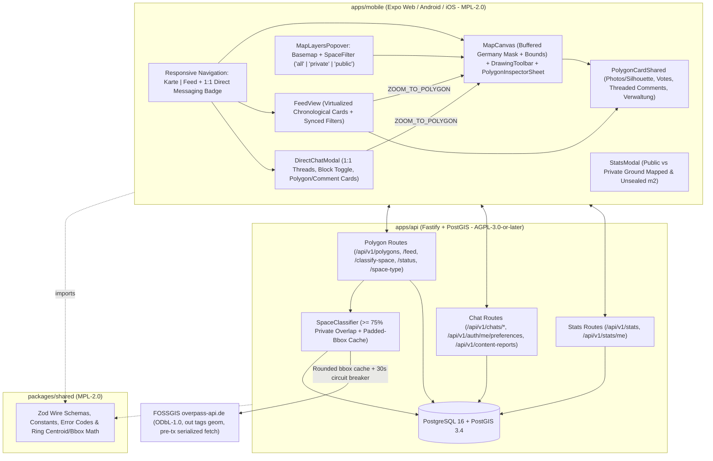
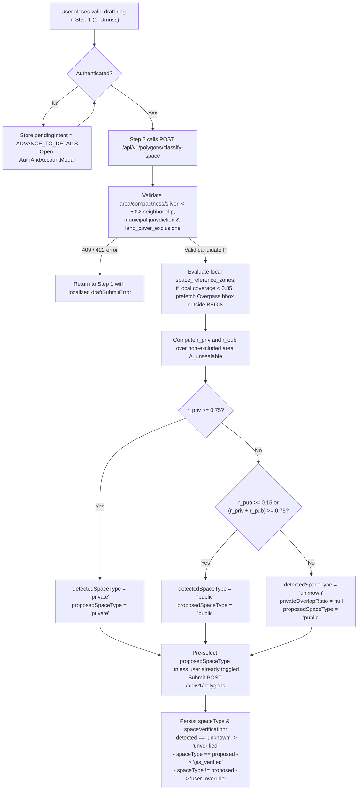

# OpenUnseal — Public/Private GIS Classification, Social Feed, 1:1 Direct Messaging & Germany Cutaway Specification

**Status:** Pre-Implementation Specification  
**Target Directories:** [packages/shared](packages/shared/package.json) (`MPL-2.0`), [apps/api](apps/api/package.json) (`AGPL-3.0-or-later`), [apps/mobile](apps/mobile/package.json) (`MPL-2.0`), [test/e2e-flow.test.ts](test/e2e-flow.test.ts) (`AGPL-3.0-or-later`)

---

## 1. Problem Statement & Existing System Baseline

### 1.1 Problem Statement
OpenUnseal is a Public Participation Geographic Information System (`PPGIS`) for mapping sealed urban surfaces (asphalt, concrete, pavers) suitable for unsealing (*Entsiegelung*). Three gaps limit how citizens, private landowners, and municipalities collaborate on the platform:

1. **Undifferentiated public vs. private ground:** Every polygon in [apps/api/migrations/001_initial_schema.sql](apps/api/migrations/001_initial_schema.sql) is treated identically regardless of whether it lies on municipal streetscape or on a private courtyard, driveway, or commercial parking lot. Municipal planners cannot isolate public-land candidates, while volunteer initiatives cannot filter for private parcels whose owners welcome unsealing support. Status transitions (`proposed` -> `in_progress` -> `finished`) in [apps/api/src/routes/polygons.ts](apps/api/src/routes/polygons.ts) require administrator privileges (`requireAdmin`), preventing private landowners from recording progress on their own parcels, and statistics in [apps/api/src/polygons/repository.ts](apps/api/src/polygons/repository.ts) combine public and private unsealed areas into a single total.
2. **No privacy-preserving 1:1 coordination channel:** Contributors register under pseudonyms with non-public verified email addresses ([README.md](README.md), [apps/api/src/routes/auth.ts](apps/api/src/routes/auth.ts)). Both private-parcel owners seeking local unsealing help and contributors discussing specific proposals or public comments lack an opt-in 1:1 messaging channel that avoids publishing personal contact details in public `CC0-1.0` notes or `CC BY 4.0` comments.
3. **Viewport-only discovery and unbounded foreign map context:** Discovery in [apps/mobile/App.tsx](apps/mobile/App.tsx) is strictly spatial (`GET /api/v1/polygons?bbox=...` capped at `0.15°` span in [packages/shared/src/constants.ts](packages/shared/src/constants.ts)). Users cannot browse a chronological feed of newly submitted proposals, vote, inspect photos/comments, and jump to the map in one tap. Meanwhile, although backend municipal checks (`BKG VG250`) and aerial orthophotos (`DOP20` in [packages/shared/src/dop20Providers.ts](packages/shared/src/dop20Providers.ts)) target Germany, the MapLibre client and Nominatim address search ([apps/api/src/routes/geocode.ts](apps/api/src/routes/geocode.ts)) expose foreign tiles and worldwide search results.

### 1.2 Existing System Baseline
- **Monorepo & Split Licensing ([LICENSING.md](LICENSING.md)):**
  - [packages/shared](packages/shared/src/index.ts) (`@openunseal/shared`, `MPL-2.0`): shared constants, `ApiError` / `ErrorCode` definitions, pure ring geometry helpers ([packages/shared/src/geometry.ts](packages/shared/src/geometry.ts)), and Zod wire schemas ([packages/shared/src/schemas.ts](packages/shared/src/schemas.ts)), containing zero Node `Buffer` references (enforced by [packages/shared/test/shared.test.ts](packages/shared/test/shared.test.ts)).
  - [apps/api](apps/api/src/app.ts) (`@openunseal/api`, `AGPL-3.0-or-later`): Fastify HTTP server backed by PostgreSQL 16 + PostGIS 3.4 (migrations `001`–`011` starting at [apps/api/migrations/001_initial_schema.sql](apps/api/migrations/001_initial_schema.sql)), Argon2id password hashing ([apps/api/src/auth/crypto.ts](apps/api/src/auth/crypto.ts)) + SHA-256 hashed bearer sessions ([apps/api/src/auth/session.ts](apps/api/src/auth/session.ts)), per-route `@fastify/rate-limit` buckets keyed by normalized client IP (`normalizeRateLimitIp` in [apps/api/src/app.ts](apps/api/src/app.ts), with `global: false` so routes without a `rateLimit` config block are unlimited), `applyOptionalAuthCacheHeaders` (`Vary: Authorization` + `no-store` vs `public, max-age=5` in [apps/api/src/routes/polygons.ts](apps/api/src/routes/polygons.ts)), Nodemailer SMTP delivery ([apps/api/src/auth/mailer.ts](apps/api/src/auth/mailer.ts)), outbound SSRF-guarded (*Server-Side Request Forgery*) webhooks ([apps/api/src/util/webhooks.ts](apps/api/src/util/webhooks.ts)), and operator CLI commands ([apps/api/src/cli/admin.ts](apps/api/src/cli/admin.ts)).
  - [apps/mobile](apps/mobile/App.tsx) (`@openunseal/mobile`, `MPL-2.0`): cross-platform Expo Web (`maplibre-gl` in [apps/mobile/src/map/MapCanvas.web.tsx](apps/mobile/src/map/MapCanvas.web.tsx)) and Android/iOS (`@maplibre/maplibre-react-native` in [apps/mobile/src/map/MapCanvas.native.tsx](apps/mobile/src/map/MapCanvas.native.tsx)) client. Reducer state in [apps/mobile/src/state/appState.ts](apps/mobile/src/state/appState.ts) manages viewport features (`VIEWPORT_FEATURES_LOADED`, which preserves `selectedFeatureId` only while it remains in `overlappingFeatureIds` / `overlapIndex`), personal-contribution highlighting (`highlightMineOnly`), community review flags (`POLYGON_FLAG_UPDATED`), and deferred guest actions (`PendingIntent`). View models in [apps/mobile/src/state/viewModels.ts](apps/mobile/src/state/viewModels.ts) include `buildCommentDisplayModel` (threaded comment tree + top-comment ordering) and `deriveNavbarLayoutMode`. Runtime config (`GET /api/v1/config`, `RuntimeConfigSchema` in [packages/shared/src/schemas.ts](packages/shared/src/schemas.ts)) exposes basemap URLs, limits, and `vg250AttributionEnabled` (whether `BKG VG250` municipal attribution is active).
- **Current Proposal Lifecycle & Anti-Spam Invariants:**
  - Contributors trace a single-ring polygon (`2`–`20,000 m²`) in Step 1 (`1. Umriss`) of [apps/mobile/src/components/DrawingToolbar.tsx](apps/mobile/src/components/DrawingToolbar.tsx), advance to Step 2 (`2. Details`) via `ADVANCE_TO_DETAILS`, and submit `POST /api/v1/polygons`.
  - [apps/api/src/polygons/repository.ts](apps/api/src/polygons/repository.ts) validates ring topology, compactness, sliver width, neighbor overlap (`>= 50%` rejected with `409 POLYGON_OVERLAP`; `< 50%` auto-clipped via `ST_Difference`), rolling spatial cluster limits, municipal coverage (`municipalities` seeded from `BKG VG250` — *Bundesamt für Kartographie und Geodäsie Verwaltungsgebiete 1:250.000* with 8-digit `AGS` *Amtlicher Gemeindeschlüssel* codes, controlled by `REQUIRE_JURISDICTION`), and `land_cover_exclusions` (`LAND_COVER_CATEGORIES`: `water`, `forest_wood`, `park_green`, `farmland`, `railway`, `building` loaded from OpenStreetMap `OSM` or German cadastral land-use `ALKIS` *Amtliches Liegenschaftskatasterinformationssystem* via [apps/api/src/polygons/landCover.ts](apps/api/src/polygons/landCover.ts)). Queries also compute `municipality_max_score` (the highest positive `proposed` polygon score in the same municipality, used by `computeMunicipalityNormalizedScore` in [packages/shared/src/schemas.ts](packages/shared/src/schemas.ts) to normalize map color ramps).
  - Polygons start in `status = 'proposed'`. Voting (`+1`/`-1` in [apps/api/src/votes/repository.ts](apps/api/src/votes/repository.ts)) currently requires `status === 'proposed'` (`409 VOTING_CLOSED` otherwise). Threaded comments ([apps/api/src/comments/repository.ts](apps/api/src/comments/repository.ts)) currently reject new comments when `status === 'finished'` (`409 COMMENTS_CLOSED`), and `findTopRatedCommentId` selects a top comment (`★ Top-Kommentar`) only when `upvotes > 0`. EXIF-stripped (*Exchangeable Image File Format*) WebP photos ([apps/api/src/photos/repository.ts](apps/api/src/photos/repository.ts)) sort by `credibility_score DESC, created_at DESC, id ASC` and are flagged fake when `credibility_score <= -3` and `fake_votes > real_votes`. Unrated `proposed` polygons with zero votes, zero photos, and zero comments are deleted after `30` days (`pruneStaleUnratedPolygons`).
- **Current Privacy, Erasure, Open-Data & Moderation Contracts:**
  - Account deletion ([apps/api/src/db/integrity.ts](apps/api/src/db/integrity.ts)) supports `self_delete` (erases `users` row, sets `user_id = NULL` so contributions remain as `'deleted'`, reserves pseudonym via HMAC-SHA256 `TOMBSTONE_SECRET`), `self_delete_purge` (also deletes authored polygons, photos, and comments under `GDPR` / *General Data Protection Regulation* / `DSGVO` Art. 17), and `ban` (like `self_delete_purge` plus email/pseudonym ban tombstones).
  - User data portability (`GDPR` Art. 15 & Art. 20) is served by `GET /api/v1/auth/me/export` and CLI `export-user` via `collectUserData` in [apps/api/src/users/dataExport.ts](apps/api/src/users/dataExport.ts).
  - Bulk export (`GET /api/v1/polygons/export.geojson`) streams non-personal features under `ODbL-1.0` (*Open Data Commons Open Database License 1.0*), with contributor geometry/notes waived under `CC0-1.0` (*Creative Commons Zero 1.0 Universal*) and bulk imports checked by `assertCompatibleImportLicenseParam` in [apps/api/src/polygons/gpkgReader.ts](apps/api/src/polygons/gpkgReader.ts).
  - Illegal-content notices under EU Digital Services Act (`DSA`, Regulation (EU) 2022/2065) Art. 16 are handled by `POST /api/v1/content-reports` ([apps/api/src/routes/contentReports.ts](apps/api/src/routes/contentReports.ts)), with `DSA` Art. 17 statements of reasons sent by [apps/api/src/cli/admin.ts](apps/api/src/cli/admin.ts) and [apps/api/src/util/moderationNotice.ts](apps/api/src/util/moderationNotice.ts).

---

## 2. Goals & Non-Goals

### 2.1 Measurable Goals
1. **Creation-only public/private classification (`>= 75%` GIS private threshold):** Classify every candidate polygon against local PostGIS `space_reference_zones` (`ALKIS` / `OSM`) and server-proxied OpenStreetMap Overpass geometry over non-excluded unsealable ground. Propose `'private'` iff $r_{\text{priv}} \ge 0.75$; propose `'public'` when $r_{\text{priv}} < 0.75$ and public/total coverage is sufficient; otherwise record `detectedSpaceType = 'unknown'` and default the UI toggle to `'public'`. Flag manual creator deviations from a non-`'unknown'` detection as `space_verification = 'user_override'`. Restrict post-creation `spaceType` changes to administrators (`422 SPACE_TYPE_IMMUTABLE` for regular users; `admin_override` for admins). Target `POST /api/v1/polygons/classify-space` latency: `< 150 ms` p95 on local PostGIS or bbox-cache hits, bounded by a `4,500 ms` client abort (`[timeout:3]` upstream Overpass) and `30 s` outage circuit breaker on cold misses.
2. **Synchronized 3-way space filter (`all` | `private` | `public`) and 6-way status filters:** Provide a 3-way `spaceFilter` in `MapLayersPopover` ([apps/mobile/src/components/MapControlsBar.tsx](apps/mobile/src/components/MapControlsBar.tsx)) and the Feed header alongside 6-way `polygonFilter` (`all`, `new`, `in_progress`, `finished`, `established`, `needs_review`), rendering `private` vs. `public` proposals via MapLibre spec-compliant filtered outline layers on Web and Native.
3. **Germany-only map cutaway and geocoding:** Mask foreign overview tiles using a bundled Natural Earth `v5.1.1` 1:10m Public Domain (`CC0-1.0`) `2.5 km`-buffered Germany cutout (`<= 25 KB`) whose opacity fades to `0` by `zoom 13` so border-city streets and `DOP20` orthophotos remain unobstructed at mapping zoom, pair with `GERMANY_MAX_BOUNDS` `[[4.8, 46.6], [16.0, 55.6]]` (`minZoom` / `minZoomLevel: 5.2`), and scope `GET /api/v1/geocode` to `countrycodes=de` whenever `REQUIRE_JURISDICTION !== 'off'`.
4. **Private-owner status transitions with photo evidence, open comments, and `user_override` safeguards:** Allow the creating author of a `private` polygon (with `>= 1` non-flagged-fake photo; `admin` users exempt) to transition `status` (`proposed` / `in_progress` / `finished`), keep public comments open on `'finished'` `private` polygons, and keep community `+1`/`-1` voting open and `'needs_review'` visibility active on `user_override` polygons until an admin confirms `spaceType`.
5. **Privacy-by-default 1:1 Direct Messaging:** Provide persistent 1:1 conversations (`chat_threads`, `chat_messages`) supporting both opt-in private-parcel inquiries (`polygons.allow_chat_contact`) and opt-in contributor messaging (`users.allow_direct_messages`, default `FALSE` per `GDPR` Art. 25(2)), hiding 0-message threads from recipient inboxes until the first message is sent, with per-thread blocking, polygon and comment reference cards, 1-tap `ZOOM_TO_POLYGON`, `GDPR` Art. 15/17/20 export/erasure, and `DSA` Art. 16/17 participant reporting and moderator deletion.
6. **Linked `Map` and `Feed` tabs + split Public/Private statistics:** Add a cursor-paginated `Feed` (`GET /api/v1/polygons/feed`, `< 100 ms` p95 for 15 items on indexed PostGIS), share card subcomponents across `PolygonInspectorSheet` and `FeedView`, keep `MapCanvas` mounted without `0x0` WebGL collapse, and report mapped and unsealed (`finished`) counts and `m²` separately for **Public Ground** and **Private Ground** in `GET /api/v1/stats`, `GET /api/v1/stats/me`, and `StatsModal`.

### 2.2 Explicit Non-Goals
- **No user-to-user email or SMTP contact relay:** Raw email addresses are never disclosed to other users; all interpersonal coordination uses 1:1 Direct Messaging.
- **No group chats, media uploads in chat, message editing, or WebSockets/push notifications:** 1:1 Direct Messaging supports text (`1..2,000` chars) plus structured polygon/comment references over foreground-gated HTTP polling.
- **No cadastral owner lookup (`ALKIS Eigentümer`):** Personal land-register ownership records under § 12 *Grundbuchordnung* (`GBO`, German Land Register Code) are never queried or stored.
- **No retroactive GIS backfill of pre-existing polygons:** Existing rows migrate to `space_type = 'public'`, `detected_space_type = 'unknown'`, `space_verification = 'unverified'`; admins can reclassify rows via `PATCH /api/v1/polygons/:id/space-type` or CLI `set-space-type`.
- **No runtime mutation of third-party basemap `landuse_*` layers:** Public vs. private distinction is rendered exclusively on OpenUnseal's own proposal layers.

---

## 3. Resolved Decisions

1. **1:1 Direct Messaging only (SMTP contact relay dropped):** `allow_email_contact` and `POST /api/v1/polygons/:id/contact-email` are omitted; all private-parcel and contributor inquiries run through in-app 1:1 Direct Messaging.
2. **Dual opt-in 1:1 Direct Messaging & physical/digital decoupling (`GDPR` Art. 25(2)):**
   - `users.allow_direct_messages` defaults to `FALSE` for all existing and new accounts.
   - `polygons.open_for_public_access` (physical walk-in openness, included in `GET /api/v1/polygons/export.geojson`) and `polygons.allow_chat_contact` (digital inquiry opt-in, omitted from `export.geojson`) are independent booleans on `private` polygons (coerced to `FALSE` on `public` polygons).
   - `POST /api/v1/chats/open` accepts a disjoint union of `{ polygonId }` (requiring a verified non-deleted author, `space_type = 'private'`, and `allow_chat_contact = true`, else `403 CONTACT_NOT_ENABLED`) or `{ recipientPseudonym }` (requiring `recipient.allow_direct_messages = true`, else `403 FORBIDDEN_CHAT_ACCESS`), returning an existing unblocked thread (`200`) if one already has messages. Zero-message threads remain hidden from the recipient's `GET /api/v1/chats` inbox until the first message is sent, and `POST /api/v1/chats/:id/messages` re-verifies contact eligibility when sending a thread's first message.
   - Either participant can block/unblock a thread via `PATCH /api/v1/chats/:id/block`.
3. **Creation-only `spaceType` for regular users; admin-only reclassification:**
   - Regular users choose `spaceType` (`'public' | 'private'`) only during creation (`POST /api/v1/polygons`). Passing `spaceType` to `PATCH /api/v1/polygons/:id` returns `422 SPACE_TYPE_IMMUTABLE`.
   - Administrators can reclassify polygons via `PATCH /api/v1/polygons/:id/space-type` (`requireAdmin`) and CLI `set-space-type <polygonId> <public|private>`, setting `space_verification = 'admin_override'`. Reclassifying `'private'` -> `'public'` coerces contact flags to `FALSE` and resets `status` to `'proposed'` (clearing `finished_at` / `finished_by`) unless `finished_by` is an `admin` account.
4. **Private-owner status transitions, photo retention & `user_override` open-voting rule:**
   - On `private` polygons, the creating author (requiring `>= 1` non-flagged-fake photo with `credibility_score > -3`, else `422 PHOTO_REQUIRED_FOR_STATUS`) and `admin` users (exempt from the photo requirement across all endpoints and UI controls) can transition `status` (`proposed` / `in_progress` / `finished`); non-author non-admins receive `403 FORBIDDEN_NOT_AUTHOR`. On `public` polygons, non-admins receive `403 FORBIDDEN_ADMIN_ONLY` (preserving [apps/api/test/v2-features.test.ts](apps/api/test/v2-features.test.ts)).
   - Non-admin `DELETE /api/v1/photos/:id` is rejected with `422 PHOTO_REQUIRED_FOR_STATUS` if deleting the photo would leave a non-`proposed` `private` polygon with zero non-flagged-fake photos.
   - When a creator overrides a `'public'` GIS detection to `'private'` (`space_verification = 'user_override'`), they may still transition status once `>= 1` non-fake photo is uploaded, **but community `+1`/`-1` voting remains open and the polygon stays visible in `'needs_review'` regardless of status** until an administrator confirms `spaceType` (`space_verification = 'admin_override'`).
   - Public comments remain open on `'finished'` `private` polygons (`409 COMMENTS_CLOSED` applies only when `status === 'finished'` and `space_type === 'public'`).
5. **Authentication required before entering Step 2 (`2. Details`):**
   - Triggering `ADVANCE_TO_DETAILS` while unauthenticated stores `pendingIntent = { type: 'ADVANCE_TO_DETAILS' }` and opens `AuthAndAccountModal`, resuming Step 2 and calling `POST /api/v1/polygons/classify-space` (`requireAuth`) after login so the creator reviews the GIS suggestion before submitting.
6. **Buffered Natural Earth `1:10m` Germany mask with zoom fade + `REQUIRE_JURISDICTION` gate:**
   - The Germany mask uses Natural Earth `v5.1.1` `ne_10m_admin_0_countries` (`ADM0_A3 = 'DEU'`, Public Domain / `CC0-1.0`), outward-buffered by `2.5 km` before simplification and faded to `fill-opacity: 0` by `zoom 13` so border towns are never obscured at street zoom, with `GERMANY_MAX_BOUNDS = [[4.8, 46.6], [16.0, 55.6]]` and `REQUIRE_JURISDICTION=off` bypass.

---

## 4. Alternatives Considered

| Area | Selected Design | Rejected Alternative | Reason for Rejection |
| :--- | :--- | :--- | :--- |
| **GIS Space Verification Source** | Seeded PostGIS `space_reference_zones` (`ALKIS` / `OSM`, `>= 85%` coverage short-circuit) + server-proxied FOSSGIS Overpass bbox query (`[timeout:3]`) | (a) Direct client-to-Overpass calls; (b) `ALKIS` owner WFS; (c) Unverified user self-declaration | (a) Leaks client IP addresses to third parties (`GDPR` Art. 5(1)(f)); (b) Owner records are restricted under § 12 `GBO` and state cadastre laws, and state WFS schemas vary across 16 *Bundesländer*; (c) Provides no check against misclassifying public streets as private. |
| **Private & Contributor Contact** | In-app pseudonymous 1:1 Direct Messaging (`chat_threads`, `chat_messages`) with dual opt-in (`allow_chat_contact` / `allow_direct_messages`) | (a) Outbound SMTP relay with sender `Reply-To`; (b) Per-polygon `(polygon_id, inquirer_user_id)` threads only | (a) Discloses the sender's email address on first message and duplicates moderation surface; (b) Fragments repeat conversations between the same two contributors across multiple parcels and blocks opt-in comment/contributor follow-ups. |
| **Guest Drawing & Step 2 Auth** | Gate Step 2 (`ADVANCE_TO_DETAILS`) on authentication and keep `POST /api/v1/polygons/classify-space` behind `requireAuth` | Expose `POST /api/v1/polygons/classify-space` via `optionalAuth` and defer login to `SUBMIT_DRAFT` | Anonymous `/api/v1/polygons/classify-space` exposes PostGIS and upstream Overpass slots to unauthenticated scraping, while post-login auto-submit could bypass user review of late GIS suggestions. |
| **Germany Cutaway Dataset & Zoom Behavior** | Bundled `2.5 km`-buffered Natural Earth `1:10m` (`CC0-1.0`, `<= 25 KB`) in `apps/mobile/src/map/` fading `fill-opacity` to `0` by `zoom 13` | (a) Bundling `BKG VG250` (`dl-de/by-2-0`) or `OSM` (`ODbL-1.0`); (b) All-zoom `fill-opacity: 1` unbuffered `1:10m` mask | (a) Triggers attribution/copyleft duties inside `MPL-2.0` bundles even when `vg250AttributionEnabled` is false; (b) `1:10m` generalization (`1–3 km`) cuts across border towns at `zoom 16–20` unless outward-buffered and faded out at street zoom. |
| **`space_type` Immutability** | Route/repository guard (`422 SPACE_TYPE_IMMUTABLE` on `PATCH /api/v1/polygons/:id`) + admin endpoint/CLI (`admin_override`) | Unconditional PostgreSQL `BEFORE UPDATE` trigger on `polygons.space_type` | Blocks administrators and CLI moderation commands from correcting misclassified rows. |
| **1:1 Direct Messaging Transport** | Foreground-gated HTTP delta polling (`5 s` open thread; `60 s` foreground unread badge) | WebSockets (`@fastify/websocket`), Server-Sent Events (`SSE`), or FCM/APNs push notifications | Keeping transport stateless HTTP avoids long-lived connection lifecycle management across proxies/mobile backgrounding, and skipping FCM/APNs preserves self-hosted, data-minimal operation without third-party push credentials. |
| **Social Feed Scope & Imports** | Nationwide chronological cursor feed (`GET /api/v1/polygons/feed`) with `spaceFilter`, `filter`, and `origin` (`citizen` vs all) | Viewport-only `bbox` list or unfiltered bulk-import mixing | Viewport-only lists require panning across Germany to discover new activity; supporting an `origin` filter prevents `2,000`-row admin imports (`POST /api/v1/polygons/import`) from burying citizen submissions. |
| **0-Photo Feed Card Visuals** | Inline `<svg>` on Web + positioned React Native `<View>` edge segments on Native | Adding `react-native-svg` or server-rendered static map thumbnails | Avoids native binary dependencies and third-party license churn for simple `<= 201`-vertex ring previews. |

---

## 5. System Architecture & Data Flow

### 5.1 Component Architecture

### 5.2 Creation-Time GIS Space Classification & Override Flow

---

## 6. Germany GIS Space Classifier & Licensing Specification

### 6.1 Legal, Privacy & Open-Data Licensing Rules
- **No personal cadastral data:** Official German cadastral owner records (`ALKIS Eigentümer`) are protected personal data under § 12 `GBO` and `GDPR`. `SpaceClassifier` evaluates only non-personal functional land-use and access geometry.
- **Server-side proxy & contributor minimization:** Client devices never connect directly to `overpass-api.de`. Backend Overpass requests fetch tags and geometry only (never contributor metadata), and `/auth/privacy` ([apps/api/src/routes/authPages.ts](apps/api/src/routes/authPages.ts)) discloses server-proxied Overpass land-use lookups alongside Nominatim and `DOP20`.
- **Distinct verification sources & `ODbL-1.0` export attribution:**
  - `SPACE_VERIFICATION_SOURCES` distinguishes `'alkis'`, `'osm_local'` (locally imported datasets via `load-space-zones`), and `'osm_overpass'` (live FOSSGIS Overpass, `ODbL-1.0`).
  - `load-space-zones` validates dataset licenses via `assertCompatibleImportLicenseParam` in [apps/api/src/polygons/gpkgReader.ts](apps/api/src/polygons/gpkgReader.ts) and persists an `import_attributions` row linked from `space_reference_zones.import_attribution_id`.
  - `PolygonRepository.listActiveImportAttributions` unions attributions linked via `polygons.import_attribution_id` with attributions linked via `space_reference_zones` whenever exported polygons carry the corresponding `space_verification_source` (`'alkis'` or `'osm_local'`), ensuring `GET /api/v1/polygons/export.geojson` emits all active `CC-BY-4.0`, `dl-de/by-2-0`, and `ODbL-1.0` upstream notices.

### 6.2 Three-Tier Spatial Precedence, Excluded Land-Cover Subtraction & `>= 75%` Formula
In both `OSM` and `ALKIS`, residential and commercial land-use polygons cover entire urban blocks including municipal streets, buildings, and gardens. To align classification with `land_cover_exclusions` (`LAND_COVER_CATEGORIES`: `water`, `forest_wood`, `park_green`, `farmland`, `railway`, `building` in [packages/shared/src/constants.ts](packages/shared/src/constants.ts)), `SpaceClassifier` evaluates the neighbor-clipped candidate polygon $P$ against excluded geometry $G_{\text{excl}}$ (union of seeded `land_cover_exclusions` and Overpass polygons matching `classifyLandCoverFeatureProperties` in [apps/api/src/polygons/landCover.ts](apps/api/src/polygons/landCover.ts)) and three land-use tiers:

1. **Tier 1 — Explicit Private Unsealable Ground ($G_{\text{priv,explicit}}$):**
   - Seeded `space_reference_zones` with `tier = 'explicit_private'`.
   - Non-excluded `OSM` paved areas (`amenity = 'parking'`, `highway = 'service'`, `man_made = 'courtyard'`, `landuse = 'garages'`, `area = 'yes'`) and buffered private service driveways/aisles (`2.5 m` half-width) carrying explicit private restriction tags (`access` in `private`/`no`/`customers`/`residents`/`employees`/`delivery`/`permit`/`members`, `ownership = 'private'`, or `operator:type = 'private'`).
2. **Tier 2 — Public Civic & Traffic Ground ($G_{\text{pub}}$):**
   - Seeded `space_reference_zones` with `tier = 'public'` (`ALKIS` road, path, and public plaza classes).
   - Non-excluded `OSM` public plazas, pedestrian zones, civic/school grounds, and playgrounds without private `access` tags, plus buffered public `highway` centerlines (`6.5 m` half-width for `primary`/`secondary`/`trunk`; `3.25 m` for `tertiary`/`residential`/`unclassified`/`living_street` so narrow German *Wohnstraßen* do not intrude into adjacent private front-yard parking pads; `2.0 m` for `pedestrian`/`footway`/`cycleway`/`path`/`steps`).
3. **Tier 3 — Parcel / Block Private Landuse ($G_{\text{priv,landuse}}$):**
   - Seeded `space_reference_zones` with `tier = 'landuse_private'` (`ALKIS` residential, commercial/industrial, and mixed-use parcel classes).
   - Non-excluded `OSM` polygonal `landuse` in `residential`, `commercial`, `industrial`, `retail`, `garages`, `farmyard`.

**Disjoint Effective Sets & Non-Excluded Denominator:**
$$G_{\text{pub,eff}} = \left(G_{\text{pub}} \setminus G_{\text{priv,explicit}}\right) \setminus G_{\text{excl}}$$
$$G_{\text{priv,eff}} = \left(G_{\text{priv,explicit}} \cup \left(G_{\text{priv,landuse}} \setminus G_{\text{pub,eff}}\right)\right) \setminus G_{\text{excl}}$$
$$A_{\text{unsealable}} = \max\!\left(0.01,\, \text{area}(P \setminus G_{\text{excl}})\right), \qquad r_{\text{priv}} = \frac{\text{area}(P \cap G_{\text{priv,eff}})}{A_{\text{unsealable}}}, \qquad r_{\text{pub}} = \frac{\text{area}(P \cap G_{\text{pub,eff}})}{A_{\text{unsealable}}}$$
Because $G_{\text{excl}}$ is subtracted from both effective sets and from denominator $A_{\text{unsealable}}$, a 100% private courtyard clipping `25%–34%` of an adjacent house roof (`< 35%` building limit) still yields $r_{\text{priv}} = 1.0 \ge 0.75$ (`'private'`), and $0 \le r_{\text{priv}} + r_{\text{pub}} \le 1$.

- **Decision & source rules:**
  - Local `space_reference_zones` short-circuits Overpass only when seeded zones cover $(r_{\text{priv}} + r_{\text{pub}}) \ge 0.85$ and both public and private tiers exist in the municipality/envelope (`source = 'alkis'` when `alkis` zone area $\ge$ `osm_local` area, else `'osm_local'`). Otherwise, Overpass features for $P$'s `20 m`-padded bbox are merged (`source = 'osm_overpass'` when Overpass contributes; `'alkis'`/`'osm_local'` if Overpass returns empty/timeout and local coverage alone satisfies the decision thresholds).
  - If $r_{\text{priv}} \ge 0.75$: `detectedSpaceType = 'private'`, `proposedSpaceType = 'private'`, `privateOverlapRatio = round4(r_priv)`.
  - Else if $r_{\text{pub}} \ge 0.15$ or $(r_{\text{priv}} + r_{\text{pub}}) \ge 0.75$: `detectedSpaceType = 'public'`, `proposedSpaceType = 'public'`, `privateOverlapRatio = round4(r_priv)`.
  - Else: `detectedSpaceType = 'unknown'`, `proposedSpaceType = 'public'`, `privateOverlapRatio = null`, `source = null`.

### 6.3 Pre-Transaction Prefetching, Padded-Bbox Cache & Outage Circuit Breaker
- **Validation before Overpass & pre-`BEGIN` HTTP isolation:** Both `POST /api/v1/polygons/classify-space` and `POST /api/v1/polygons` validate Germany bounds (when `REQUIRE_JURISDICTION !== 'off'`), ring geometry, area/compactness/sliver limits, `< 50%` neighbor clipping, municipal jurisdiction, and `land_cover_exclusions` before calling Overpass. Overpass HTTP requests run **outside PostgreSQL `BEGIN` transactions** through a shared `1`-in-flight serialized queue (`500 ms` minimum spacing, `[timeout:3]` upstream, `4,500 ms` `AbortSignal`), cached by `0.005°`-rounded padded bbox (`500` entries, `30 min` TTL) so `POST /api/v1/polygons` reuses the Step 2 Overpass response without a second network trip. Two consecutive upstream timeouts/5xx responses trip a `30 s` circuit breaker that skips Overpass immediately (`'unknown'` fallback) rather than stalling submissions.

---

## 7. Data Model, API Contracts & Privacy Invariants

### 7.1 Database Schema Overview (Migrations `012` & `013`)
1. **Migration `012_public_private_spaces.sql` (Task 2):**
   - **`polygons`:** Adds `space_type` (`'public' | 'private'`), `detected_space_type` (`'public' | 'private' | 'unknown'`), `private_overlap_ratio` (`DOUBLE PRECISION`, nullable), `space_verification` (`'gis_verified' | 'user_override' | 'admin_override' | 'unverified'`), `space_verification_source` (`'alkis' | 'osm_local' | 'osm_overpass'`, nullable), `open_for_public_access` (`BOOLEAN`), and `allow_chat_contact` (`BOOLEAN`), constrained so `public` polygons force both contact/access booleans to `FALSE`. Drops redundant `idx_polygons_created_at_desc` (reusing `idx_polygons_created_id` reverse scan) and adds `(space_type, created_at DESC, id DESC)`, `(status, created_at DESC, id DESC)`, and partial `(space_verification) WHERE space_verification = 'user_override'` indexes.
   - **`space_reference_zones`:** Stores local `ALKIS` / `OSM` land-use polygons (`source`, `tier`, `category`, `import_attribution_id`, `geom` with `GIST` index).
2. **Migration `013_direct_messaging.sql` (Task 4):**
   - **`users`:** Adds `allow_direct_messages BOOLEAN NOT NULL DEFAULT FALSE`.
   - **`chat_threads`:** Canonical 1:1 threads (`user_low_id < user_high_id`, `ON DELETE SET NULL`), `low_last_read_at`, `high_last_read_at`, `blocked_by_low`, `blocked_by_high`, `message_count INTEGER NOT NULL DEFAULT 0`, `last_message_at`, partial unique pair index, and participant `last_message_at DESC` indexes.
   - **`chat_messages`:** Stores `thread_id` (`ON DELETE CASCADE`), `sender_user_id` (`ON DELETE SET NULL`), `body` (`1..2000` chars), `referenced_polygon_id` (`ON DELETE SET NULL`), `referenced_comment_id` (`ON DELETE SET NULL`), and `created_at`, with `(thread_id, created_at DESC, id DESC)` and partial FK indexes on `sender_user_id`, `referenced_polygon_id`, and `referenced_comment_id`.

### 7.2 API Endpoint & Wire Contract Matrix

| Method & Path | Auth & Rate Limit | Request / Query Contract | Response Contract & Status | Error Behaviour |
| :--- | :--- | :--- | :--- | :--- |
| `GET /api/v1/config` | Public | *(none)* | `200` `RuntimeConfigSchema` (`+ germanyConfinementEnabled?: boolean`, derived from `requireJurisdiction !== 'off'`) | — |
| `POST /api/v1/polygons/classify-space` | `requireAuth`, `classifySpace` (`30/min`) | `ClassifySpaceRequestSchema` (`{ geometry }`) | `200` `ClassifySpaceResponseSchema` (`{ proposedSpaceType, detectedSpaceType, privateOverlapRatio, thresholdRatio, wasAutoClipped, source }`) | `401 AUTH_REQUIRED`, `409 POLYGON_OVERLAP`, `422 GEOMETRY_*` / `OUTSIDE_JURISDICTION` / `LAND_COVER_EXCLUDED` |
| `POST /api/v1/polygons` | `requireAuth`, `createPolygon` (`30/min`) | `CreatePolygonRequestSchema` (`+ spaceType, openForPublicAccess, allowChatContact`) | `201` `PolygonFeatureSchema` (`+ spaceType, detectedSpaceType, privateOverlapRatio, spaceVerification, spaceVerificationSource, openForPublicAccess, allowChatContact, authorAllowDirectMessages`) | Existing creation errors; coerces contact/access flags to `false` when `spaceType === 'public'` |
| `PATCH /api/v1/polygons/:id` | `requireAuth`, `mutatePolygon` (`30/min`) | `PatchPolygonRequestSchema` (`surfaceType?, note?, openForPublicAccess?, allowChatContact?`) | `200` `PolygonFeatureSchema` | `422 SPACE_TYPE_IMMUTABLE` if `'spaceType' in body`; `403 FORBIDDEN_NOT_AUTHOR` |
| `PATCH /api/v1/polygons/:id/space-type` | `requireAdmin`, `mutatePolygon` (`30/min`) | `PatchPolygonSpaceTypeRequestSchema` (`{ spaceType }`) | `200` `PolygonFeatureSchema` (`space_verification = 'admin_override'`; resets non-admin status on `'private'` -> `'public'`) | `403 FORBIDDEN_ADMIN_ONLY`, `404 NOT_FOUND` |
| `PATCH /api/v1/polygons/:id/status` | `requireAuth`, `mutatePolygon` (`30/min`) | `PatchPolygonStatusRequestSchema` (`{ status }`) | `200` `PolygonFeatureSchema` (emits `polygon.status_changed` webhook) | `403 FORBIDDEN_ADMIN_ONLY` (`public`); `403 FORBIDDEN_NOT_AUTHOR` (`private` non-author); `422 PHOTO_REQUIRED_FOR_STATUS` (non-admin `private` when `status !== 'proposed'` and `< 1` non-fake photo) |
| `GET /api/v1/polygons` | `optionalAuth` | `PolygonListQuerySchema` (`bbox`, `filter` (`6` values), `spaceFilter` (`3` values)) | `200` `PolygonCollectionResponseSchema` | `422 BBOX_TOO_LARGE` / `VALIDATION_ERROR` |
| `GET /api/v1/polygons/feed` | `optionalAuth` | `PolygonFeedQuerySchema` (`cursor?`, `limit?` `1..40` default `15`, `filter?`, `spaceFilter?`, `origin?` `'all' \| 'citizen'`) | `200` `PolygonFeedResponseSchema` (`{ items: [{ feature, photos, topComment }], nextCursor }`) | `422 VALIDATION_ERROR` on invalid cursor |
| `GET /api/v1/polygons/export.geojson` | Public, `exportGeoJson` (`6/min`) | `?includeMunicipality=true\|false` | `200` streamed GeoJSON of `ExportPolygonFeatureSchema` (keeps `spaceType..openForPublicAccess`; omits `allowChatContact` & `authorAllowDirectMessages`; unions `space_reference_zones` attributions) | `503 SERVICE_UNAVAILABLE` on stream timeout |
| `POST /api/v1/polygons/import` | `requireAdmin` | Multipart `.geojson`/`.gpkg` + license query params | `200` `ImportPolygonsResponseSchema` (maps feature `space_type`/`spaceType` without live Overpass; default `'public'`/`'unverified'`) | `413`, `415`, `422 VALIDATION_ERROR` |
| `PATCH /api/v1/auth/me/preferences` | `requireAuth`, `accountPreferences` (`20/min`) | `PatchAccountPreferencesRequestSchema` (`{ allowDirectMessages: boolean }`) | `200` `AuthUserSchema` (`+ allowDirectMessages: boolean`) | `401 AUTH_REQUIRED`, `422 VALIDATION_ERROR` |
| `POST /api/v1/chats/open` | `requireAuth`, `openChat` (`20/min`) | `OpenDirectChatRequestSchema` (`{ polygonId }` \| `{ recipientPseudonym }`, disjoint) | `200` (existing) or `201` (created) `ChatThreadSchema` | `422 FORBIDDEN_SELF_CONTACT`, `403 CONTACT_NOT_ENABLED` (`{ polygonId }`), `403 FORBIDDEN_CHAT_ACCESS` (`{ recipientPseudonym }` or blocked), `404 NOT_FOUND` |
| `GET /api/v1/chats` | `requireAuth` | *(none)* | `200` `ChatThreadListResponseSchema` (`{ threads: ChatThreadSchema[] }`, hides `0`-message threads from non-initiator) | `401 AUTH_REQUIRED` |
| `GET /api/v1/chats/unread-count` | `requireAuth` | *(none)* | `200` `ChatUnreadCountResponseSchema` (`{ unreadCount: number }`, total unread messages across unblocked threads) | `401 AUTH_REQUIRED` |
| `GET /api/v1/chats/:id/messages` | `requireAuth` | `ChatMessagesQuerySchema` (`limit?` `1..50`, `before?` \| `after?` `base64url("${createdAtIso}\|${id}")`) | `200` `ChatMessagesResponseSchema` (`{ thread, messages, nextBeforeCursor, nextAfterCursor }`, `messages` sorted `ASC`) | `403 FORBIDDEN_CHAT_ACCESS`, `404 NOT_FOUND`, `422 VALIDATION_ERROR` |
| `POST /api/v1/chats/:id/messages` | `requireAuth`, `sendChatMessage` (`30/min`) | `CreateChatMessageRequestSchema` (`{ body, referencedPolygonId?, referencedCommentId? }`) | `201` `ChatMessageSchema` | `403 FORBIDDEN_CHAT_ACCESS` / `CONTACT_NOT_ENABLED`, `404 NOT_FOUND`, `422 VALIDATION_ERROR` |
| `PATCH /api/v1/chats/:id/block` | `requireAuth`, `chatBlock` (`20/min`) | `BlockChatThreadRequestSchema` (`{ blocked: boolean }`) | `200` `ChatThreadSchema` | `403 FORBIDDEN_CHAT_ACCESS`, `404 NOT_FOUND` |
| `GET /api/v1/stats` & `/api/v1/stats/me` | Public / `requireAuth` | *(none)* | `200` `PublicStatsResponseSchema` / `PersonalStatsResponseSchema` (`+ spaceBreakdown: { public, private }`) | `401 AUTH_REQUIRED` on `/api/v1/stats/me` |

### 7.3 Query, Concurrency, Erasure & Moderation Invariants
- **Shared `PolygonFilter` & `SpaceFilter` semantics:** `spaceFilter` filters `'all'`, `'private'`, or `'public'`. `filter` filters `'all'`, `'new'` (`<= 7 days`), `'in_progress'`, `'finished'`, `'established'` (`> 7 days`), and `'needs_review'` (`space_verification = 'user_override'` OR unvoted `proposed` polygons). `getPersonalStats` computes `spaceBreakdown` strictly over polygons authored by the authenticated user (`user_id = viewerUserId`), matching existing personal totals. `buildPublicPolygonWebhookData` mirrors `ExportPolygonFeatureSchema` non-personal fields (omitting `allowChatContact` and `authorAllowDirectMessages`).
- **Feed batch loading & stale pruning:** `GET /api/v1/polygons/feed` resolves photos via `PhotoRepository.listByPolygonIds` and positive-upvote top comments via SQL `DISTINCT ON (polygon_id)` in `CommentRepository.findTopCommentsByPolygonIds` (`null` when `upvotes === 0`). `pruneStaleUnratedPolygons` retains its existing public-engagement criteria without a `chat_messages` exemption; pruned polygons clear `chat_messages.referenced_polygon_id` cleanly via `ON DELETE SET NULL`.
- **1:1 Direct Messaging concurrency, read watermarks & deletion sync:**
  - Transactional writes lock `users` in canonical `(user_low_id, user_high_id)` order before locking `chat_threads FOR UPDATE`.
  - Initial and `after` fetches advance the viewer's `*_last_read_at` to the latest *returned* message's `created_at` (writing to PostgreSQL only when the watermark increases, avoiding write locks on idle `5 s` polls; when `> limit` messages exist after `after`, `nextAfterCursor` pages forward in chronological order so unseen messages `51+` are never marked read prematurely). `ChatThreadSchema.messageCount` allows an open conversation to detect message deletions and refresh when `messageCount` decreases.
  - `deleteOrBanUserAccount` and CLI `delete-chat-message` lock affected `chat_threads FOR UPDATE` (`ORDER BY id ASC`), recompute `message_count` and `last_message_at` from remaining messages, and delete threads with zero remaining messages or `(NULL, NULL)` participants.
  - `collectUserData` exports `account.allowDirectMessages`, polygon space/contact columns, participating `chatThreads` (`messageCount > 0`), and sent `chatMessages`.
- **DSA Art. 16/17 moderation & legal disclosures:**
  - `POST /api/v1/content-reports` for `targetType = 'chat_message'` requires thread-participant authentication (`401` if unauthenticated, `404` if non-participant, `422` on self-reported own message), renders `'deleted'` if `sender_user_id` is `NULL`, sends receipts only to the authenticated reporter's verified account email, and includes the message excerpt/metadata in the operator notice. [apps/api/src/routes/authPages.ts](apps/api/src/routes/authPages.ts) is updated on `/auth/privacy` and `/auth/terms` to disclose 1:1 Direct Messaging storage, `self_delete` anonymization, non-`CC BY 4.0` status of private messages, server-proxied Overpass requests, and participant-initiated `DSA` Art. 16 reporting under § 3 *Telekommunikation-Digitale-Dienste-Datenschutz-Gesetz* (`TDDDG`, German Telecommunications Digital Services Data Protection Act) and `GDPR` Art. 6(1)(c)/(f). CLI `delete-chat-message <messageId> [reason]` removes offending messages and sends a `DSA` Art. 17 statement of reasons (`chat_message_deleted`).

---

## 8. Cross-Platform Client Specification

### 8.1 Germany Cutaway & Proposal Layer Stack ([apps/mobile/src/map/styleBuilder.ts](apps/mobile/src/map/styleBuilder.ts))
- **Bundled Germany cutaway (`apps/mobile/src/map/germanyBorder.ts`):** When `config.germanyConfinementEnabled !== false`, Web and Native `MapCanvas` mount `germany-mask-source` and `germany-border-source`.
- **Layer Z-order & zoom opacity fade:** `orthophoto-raster-layer` anchors below `'germany-mask-fill'` (falling back to `'proposals-fill'` when `germanyConfinementEnabled === false`). `'germany-mask-fill'` interpolates `fill-opacity` from `1` (`zoom <= 11`) to `0` (`zoom >= 13`) using `palette.bgMapCanvas`, and `'germany-border-outline'` sits below `'proposals-fill'`. Restored `savedViewport` bounds on `CONFIG_LOADED` are clamped to `GERMANY_MAX_BOUNDS`, and GNSS `Locate Me` fixes outside Germany show a localized notice instead of silently clamping.
- **Spec-compliant private outline layer:** Because MapLibre `line-dasharray` does not accept feature-data expressions, `buildPolygonLayerSpecs` emits two `filter`-gated outline layers: `'proposals-outline'` (solid, for `public` or selected polygons) and `'proposals-outline-private'` (constant dashed stroke, for unselected `private` polygons), both registered in `INTERACTIVE_PROPOSAL_LAYER_IDS` and reflected in the map legend.

### 8.2 Responsive Navigation, Persistent Map Canvas & Unified `ZOOM_TO_POLYGON`
- **Responsive tab placement:** On tablet/desktop (`tier !== 'compact'`, `>= 768 px`), `MapControlsBar` renders the `Karte | Feed` switcher and `1:1 Direct Messaging` badge in the top bar. On compact viewports (`tier === 'compact'`, `< 768 px`), `MobileBottomTabBar` renders `Karte`, `Feed`, and `Chat` at the bottom with `44 dp` touch targets so `MapControlsBar` preserves its single-row width budget.
- **Sized hidden map container & fetch gating:** While `activeMainTab === 'feed'`, `App.tsx` keeps `MapCanvas` mounted at full stage dimensions with `opacity: 0` and `pointerEvents: 'none'`, defers viewport `listPolygons` refetches until `activeMainTab` returns to `'map'`, and triggers `map.resize()` on visibility restore.
- **Unified `ZOOM_TO_POLYGON`:** Closes `DirectChatModal`, switches `activeMainTab` to `'map'` and `mode` to `'browse'`, fetches `apiClient.getPolygon(id)` if absent, resets `spaceFilter`/`polygonFilter`/`highlightMineOnly` when they would hide the target polygon, sets `overlappingFeatureIds: [polygon.id]`, `overlapIndex: 0`, and `selectedFeatureId: polygon.id`, and animates the camera to padded ring bounds (`0.0001°` span threshold, `maxZoom: 18.5`, centroid fallback).

### 8.3 Step 2 Wizard, Shared Card Components, Feed, 1:1 Direct Messaging & Statistics
- **Step 2 (`DrawingToolbar.tsx`):** Calls `apiClient.classifyPolygonSpace` on entry. If the endpoint returns `409` or `422` (`POLYGON_OVERLAP`, `LAND_COVER_EXCLUDED`, `OUTSIDE_JURISDICTION`, `GEOMETRY_*`), the reducer returns to Step 1 (`geometry`) with localized `draftSubmitError` so users never fill out Step 2 for an invalid draft. On `200`, pre-selects `proposedSpaceType` unless the user already toggled it while in flight; displays a `GIS-Abgleich` summary (`Privatgrund`-Überlappung in `%`, Schwelle `>= 75 %`); unconditionally displays the creation-only immutability notice; and reveals independent `openForPublicAccess` and `allowChatContact` switches when `'private'` is selected.
- **Normalized Feed & Shared Card Components (`PolygonCardShared.tsx`, `FeedView.tsx`):** `PolygonCardShared` provides shared `PolygonSpaceBadges` (displaying `Öffentlicher Raum` / `Privatfläche` and `GIS-Abgleich` / `Nutzer-Override`, never claiming legal ownership certification), `PolygonPhotoStage`, `PolygonGeometrySilhouette` (`<svg>` on Web, positioned `<View>` segments on Native), `PolygonVoteBar` (enabled on `proposed` and `user_override` polygons), `PolygonCommentsSection` (lazily loading full threaded comments via `apiClient.listPolygonComments` when expanded on a Feed card), and `PolygonManageControls`. Polygon features are synchronized across Map and Feed reducer state, and auth transitions (`AUTH_SUCCEEDED`, `SESSION_EXPIRED`, `LOGOUT_SUCCEEDED`, `ACCOUNT_DELETED`) scrub or refresh viewer-specific flags (`isAuthor`, `isUploader`, `myVote`) across both views.
- **Recipient Selection in `DirectChatModal.tsx`, Account Settings & `StatsModal.tsx`:**
  - `"1:1 Chat starten"` (shown on `private` polygons with `allowChatContact = true`) calls `POST /api/v1/chats/open` with `{ polygonId }` and opens the thread with `{ polygonId }` pre-attached.
  - `"Im Chat teilen"` (on any polygon) and `"Im Chat referenzieren"` (on any public comment) store `pendingChatAttachment` and open `DirectChatModal` in thread/recipient picker mode (pre-filling `@comment.authorPseudonym` for comments when active and not self).
  - `AuthAndAccountModal` exposes the opt-in `allowDirectMessages` toggle; `StatsModal` adds the **Öffentlicher Grund vs. Privatgrund** mapped and unsealed (`Entsiegelt`) breakdown on both `Gesamt` and `Meine Beiträge` tabs.

---

## 9. Risks, Limits & Mitigations

| Risk / Limit | Impact | Mitigation / Accepted Trade-Off |
| :--- | :--- | :--- |
| **Upstream FOSSGIS Overpass outage or dynamic slot throttling** | Cold GIS lookups could stall Step 2 or `POST /api/v1/polygons` | Validate geometry/bounds/land-cover first; serialize Overpass to `1` in-flight request outside DB transactions with `[timeout:3]` / `4,500 ms` abort, `0.005°` bbox cache (`30 min` TTL), and `30 s` failure circuit breaker degrading to `'unknown'` (`'unverified'`). |
| **Creator overrides `'public'` GIS detection to `'private'` (`user_override`) and marks `'finished'`** | Could prematurely lock out downvotes or inflate unsealed totals | Require `>= 1` non-fake photo (and block deleting the last non-fake photo while non-`proposed`), keep `+1`/`-1` voting open and keep the polygon in `'needs_review'` until an admin confirms `spaceType`, and reset non-admin status to `'proposed'` if reclassified to `'public'`. |
| **Unsolicited 1:1 Direct Messaging spam or empty-thread probing** | Degrades contributor privacy and inbox usability | Default `users.allow_direct_messages` to `FALSE`; hide `0`-message threads from recipient inboxes and re-verify eligibility on first message; rate-limit `openChat` (`20/min`) and `sendChatMessage` (`30/min`); provide per-thread blocking and `DSA` Art. 16/17 moderation. |
| **Heuristic `OSM` land-use & `1:10m` border generalization** | `OSM` tags are not cadastral parcel boundaries; `1:10m` coastline/border has `1–3 km` generalization | Label verification as `GIS-Abgleich` and support municipal `ALKIS` seeding via `load-space-zones`; buffer the Germany mask outward by `2.5 km` and fade mask opacity to `0` by `zoom 13`. |
| **HTTP polling load (`N_open / 5 + N_foreground / 60 req/s`)** | At `100` open chats and `600` foreground sessions, adds `~30 req/s` of indexed PK/FK reads | Polling pauses immediately when backgrounded/hidden or modal-closed, and idle `after` polls perform zero DB writes. Accepted capacity trade-off prior to introducing SSE/WebSockets. |

---

## Detailed Implementation Plan

### Goal

* **Goal:** Deliver four buildable end-to-end vertical slices adding the Public Domain Germany map cutaway and geocoder scoping, creation-only public/private GIS space classification (`>= 75%` private threshold) with synchronized 3-way filtering, private-owner status transitions, and split public/private statistics, a chronological social feed sharing Inspector card components, and opt-in 1:1 Direct Messaging with polygon/comment references and GDPR/DSA compliance.
* **Outcome:** `npm run build && npm run typecheck && npm test`

### Task 1: Germany Area-of-Interest Cutaway, Camera/Viewport Confinement and Geocoder Scoping

* **Files:**
  - `packages/shared/src/constants.ts` (Modify)
  - `packages/shared/src/geometry.ts` (Modify)
  - `packages/shared/src/schemas.ts` (Modify)
  - `packages/shared/src/index.ts` (Modify)
  - `packages/shared/test/shared.test.ts` (Modify)
  - `apps/api/src/config.ts` (Modify)
  - `apps/api/src/routes/geocode.ts` (Modify)
  - `apps/api/test/v2-features.test.ts` (Modify)
  - `apps/mobile/src/map/germanyBorder.ts` (Create)
  - `apps/mobile/src/map/styleBuilder.ts` (Modify)
  - `apps/mobile/src/map/index.ts` (Modify)
  - `apps/mobile/src/map/MapCanvas.web.tsx` (Modify)
  - `apps/mobile/src/map/MapCanvas.native.tsx` (Modify)
  - `apps/mobile/src/state/appState.ts` (Modify)
  - `apps/mobile/src/i18n/translations.ts` (Modify)
  - `apps/mobile/App.tsx` (Modify)
  - `apps/mobile/test/map-style.test.ts` (Modify)
  - `apps/mobile/test/state-and-client.test.ts` (Modify)
  - `apps/mobile/test/location-and-ui.test.ts` (Modify)
  - `LICENSING.md` (Modify)
* **Depends on:** none
* **Called by:** `apps/mobile/src/map/styleBuilder.ts`, `apps/mobile/src/map/MapCanvas.web.tsx`, `apps/mobile/src/map/MapCanvas.native.tsx`, `apps/mobile/App.tsx`, `apps/api/src/routes/geocode.ts`
* **Symbols:** `GERMANY_MAX_BOUNDS`, `GERMANY_MIN_ZOOM`, `computeExteriorRingCentroid`, `computeRingBbox`, `buildGermanyInvertedMaskGeoJson`, `buildGermanyBorderOutlineGeoJson`, `buildGermanyMaskLayerSpecs`, `GERMANY_MASK_LAYER_ID`, `GERMANY_BORDER_LAYER_ID`
* **Changes:**
  - In `packages/shared/src/constants.ts`, export `GERMANY_MAX_BOUNDS = [[4.8, 46.6], [16.0, 55.6]] as const` and `GERMANY_MIN_ZOOM = 5.2`. In `packages/shared/src/geometry.ts`, move and export `computeExteriorRingCentroid(exteriorRing)` (from `apps/mobile/src/map/styleBuilder.ts`) and add `computeRingBbox(exteriorRing): [number, number, number, number]`. In `packages/shared/src/schemas.ts`, add `germanyConfinementEnabled: z.boolean().optional()` to `RuntimeConfigSchema` (keeping `z.output` optional so partial test `RuntimeConfig` fixtures stay valid, while updating `SAMPLE_CONFIG_WITH_ORTHO` in `apps/mobile/test/state-and-client.test.ts` and `SAMPLE_CONFIG` in `apps/mobile/test/location-and-ui.test.ts`). Re-export all new symbols in `packages/shared/src/index.ts`.
  - In `apps/api/src/config.ts`, set `runtimeConfig.germanyConfinementEnabled = requireJurisdiction !== 'off'`. In `apps/api/src/routes/geocode.ts`, append `url.searchParams.set('countrycodes', 'de')` when `app.config.requireJurisdiction !== 'off'` and include `app.config.requireJurisdiction` in `cacheKey`.
  - Create `apps/mobile/src/map/germanyBorder.ts` (zero Node `Buffer` usage, `<= 25 KB`) from Natural Earth `v5.1.1` `ne_10m_admin_0_countries` (`https://naciscdn.org/naturalearth/10m/cultural/ne_10m_admin_0_countries.zip`, `ADM0_A3 = 'DEU'` including mainland, Büsingen exclave, and Rügen, Usedom, Fehmarn, Sylt, Föhr, Amrum, Pellworm, Borkum, Juist, Norderney, Baltrum, Langeoog, Spiekeroog, Wangerooge, Helgoland), outward-buffered by `2.5 km` (`@turf/buffer` at generation time) and simplified at `0.004°` with RFC 7946 winding. Export `buildGermanyInvertedMaskGeoJson()` and `buildGermanyBorderOutlineGeoJson()`. Document Natural Earth `v5.1.1` (`CC0-1.0` / Public Domain) in `LICENSING.md` Section 4.
  - In `apps/mobile/src/map/styleBuilder.ts` and `apps/mobile/src/map/index.ts`, re-export `computeExteriorRingCentroid`, add `GERMANY_MASK_SOURCE_ID = 'germany-mask-source'`, `GERMANY_MASK_LAYER_ID = 'germany-mask-fill'`, `GERMANY_BORDER_SOURCE_ID = 'germany-border-source'`, `GERMANY_BORDER_LAYER_ID = 'germany-border-outline'`, and `buildGermanyMaskLayerSpecs(colorScheme)` with `fill-color: palette.bgMapCanvas` (`#DFE7E2` light / `#0C1210` dark) and zoom-faded `fill-opacity: ['interpolate', ['linear'], ['zoom'], 5, 1, 11, 0.92, 13, 0]`, plus `buildOrthophotoLayerSpec(visible, beforeId = GERMANY_MASK_LAYER_ID)`.
  - In `apps/mobile/src/map/MapCanvas.web.tsx` and `apps/mobile/src/map/MapCanvas.native.tsx`, mount the Germany mask and border layers below `'proposals-fill'` (anchoring orthophoto below `'germany-mask-fill'`), pass `maxBounds: [[4.8, 46.6], [16.0, 55.6]]` and `minZoom: GERMANY_MIN_ZOOM` on Web `MapLibreMap`, and pass `maxBounds={{ sw: [4.8, 46.6], ne: [16.0, 55.6] }}` and `minZoomLevel={GERMANY_MIN_ZOOM}` on Native `<Camera>` when `config.germanyConfinementEnabled !== false`.
  - In `apps/mobile/src/state/appState.ts` (`CONFIG_LOADED`), clamp restored `savedViewport` center/bbox into `GERMANY_MAX_BOUNDS` when `config.germanyConfinementEnabled !== false`. In `apps/mobile/App.tsx` (`handleLocateMe`) and `apps/mobile/src/i18n/translations.ts`, show a localized banner (`locationOutsideGermanyNotice`) instead of panning when GNSS coordinates fall outside `GERMANY_MAX_BOUNDS` and `germanyConfinementEnabled !== false`.
* **Verification:** `npm run build && npm run typecheck && npm test` — fails before implementation on new tests in `packages/shared/test/shared.test.ts` (`computeExteriorRingCentroid` & `computeRingBbox`), `apps/api/test/v2-features.test.ts` (`GET /api/v1/geocode` `countrycodes=de` default vs `REQUIRE_JURISDICTION=off` omission), `apps/mobile/test/map-style.test.ts` (`germanyBorder.ts <= 25 KB`, Berlin/Konstanz/Büsingen/Sylt inside cutout vs Paris/Zurich masked, `validateStyleMin` passing zoom-interpolated `germany-mask-fill` above `orthophoto-raster-layer`), and `apps/mobile/test/state-and-client.test.ts` (out-of-bounds `savedViewport` clamping on `CONFIG_LOADED` and bypass when `germanyConfinementEnabled === false`).
* **Review focus:**
  1. Confirm `germany-mask-fill` passes `@maplibre/maplibre-gl-style-spec` `validateStyleMin`, anchors above `orthophoto-raster-layer`, and fades to `0` opacity by `zoom 13`.
  2. Confirm Native `<Camera>` uses `minZoomLevel` and mutable `[number, number]` tuples for `maxBounds`.

### Task 2: Public/Private GIS Space Classification, Filtering, Lifecycle and Split Statistics End-to-End

* **Files:**
  - `packages/shared/src/constants.ts` (Modify)
  - `packages/shared/src/errors.ts` (Modify)
  - `packages/shared/src/schemas.ts` (Modify)
  - `packages/shared/src/index.ts` (Modify)
  - `packages/shared/test/shared.test.ts` (Modify)
  - `apps/api/migrations/012_public_private_spaces.sql` (Create)
  - `apps/api/src/db/testHarness.ts` (Modify)
  - `apps/api/src/config.ts` (Modify)
  - `.env.example` (Modify)
  - `.env.vps.example` (Modify)
  - `docker-compose.yml` (Modify)
  - `docker-compose.vps.yml` (Modify)
  - `apps/api/src/util/upstreamFetch.ts` (Create)
  - `apps/api/src/polygons/gpkgReader.ts` (Modify)
  - `apps/api/src/polygons/spaceZonesLoader.ts` (Create)
  - `apps/api/src/polygons/spaceClassifier.ts` (Create)
  - `apps/api/src/polygons/repository.ts` (Modify)
  - `apps/api/src/photos/repository.ts` (Modify)
  - `apps/api/src/votes/repository.ts` (Modify)
  - `apps/api/src/comments/repository.ts` (Modify)
  - `apps/api/src/routes/polygons.ts` (Modify)
  - `apps/api/src/routes/geocode.ts` (Modify)
  - `apps/api/src/routes/authPages.ts` (Modify)
  - `apps/api/src/util/webhooks.ts` (Modify)
  - `apps/api/src/users/dataExport.ts` (Modify)
  - `apps/api/src/cli/admin.ts` (Modify)
  - `apps/api/src/app.ts` (Modify)
  - `apps/mobile/src/i18n/translations.ts` (Modify)
  - `apps/mobile/src/api/client.ts` (Modify)
  - `apps/mobile/src/map/styleBuilder.ts` (Modify)
  - `apps/mobile/src/map/index.ts` (Modify)
  - `apps/mobile/src/map/MapCanvas.web.tsx` (Modify)
  - `apps/mobile/src/map/MapCanvas.native.tsx` (Modify)
  - `apps/mobile/src/state/appState.ts` (Modify)
  - `apps/mobile/src/state/viewModels.ts` (Modify)
  - `apps/mobile/src/components/DrawingToolbar.tsx` (Modify)
  - `apps/mobile/src/components/MapControlsBar.tsx` (Modify)
  - `apps/mobile/src/components/PolygonInspectorSheet.tsx` (Modify)
  - `apps/mobile/src/components/StatsModal.tsx` (Modify)
  - `apps/mobile/App.tsx` (Modify)
  - `apps/api/test/system.test.ts` (Modify)
  - `apps/api/test/polygons.test.ts` (Modify)
  - `apps/api/test/v2-features.test.ts` (Modify)
  - `apps/api/test/carbon-anti-spam.test.ts` (Modify)
  - `apps/api/test/stats.test.ts` (Modify)
  - `apps/api/test/branding-and-webhooks.test.ts` (Modify)
  - `apps/mobile/test/map-style.test.ts` (Modify)
  - `apps/mobile/test/state-and-client.test.ts` (Modify)
  - `apps/mobile/test/location-and-ui.test.ts` (Modify)
  - `test/e2e-flow.test.ts` (Modify)
* **Depends on:** 1
* **Called by:** `apps/api/src/routes/polygons.ts`, `apps/api/src/cli/admin.ts`, `apps/mobile/App.tsx`
* **Symbols:** `SPACE_TYPES`, `DETECTED_SPACE_TYPES`, `SPACE_FILTERS`, `SPACE_VERIFICATION_STATUSES`, `SPACE_VERIFICATION_SOURCES`, `SPACE_REFERENCE_TIERS`, `SpaceClassifier`, `loadSpaceZonesFile`, `ClassifySpaceRequestSchema`, `ClassifySpaceResponseSchema`, `PatchPolygonSpaceTypeRequestSchema`, `SpaceStatItemSchema`, `SpaceBreakdownSchema`, `PROPOSALS_PRIVATE_OUTLINE_LAYER_ID`
* **Changes:**
  - **Shared Contracts (`packages/shared`):** Add `SPACE_TYPES = ['public', 'private'] as const`, `DETECTED_SPACE_TYPES = ['public', 'private', 'unknown'] as const`, `SPACE_FILTERS = ['all', 'private', 'public'] as const`, `SPACE_VERIFICATION_STATUSES = ['gis_verified', 'user_override', 'admin_override', 'unverified'] as const`, `SPACE_VERIFICATION_SOURCES = ['alkis', 'osm_local', 'osm_overpass'] as const`, `SPACE_REFERENCE_TIERS = ['explicit_private', 'public', 'landuse_private'] as const`, `SPACE_CLASSIFICATION_THRESHOLDS = { PRIVATE_PROPOSAL_MIN_RATIO: 0.75, PUBLIC_MIN_RATIO: 0.15, LOCAL_SHORT_CIRCUIT_COVERAGE: 0.85 } as const`, and expand `POLYGON_FILTERS` with `'in_progress'` and `'finished'`. Add `'SPACE_TYPE_IMMUTABLE'` and `'PHOTO_REQUIRED_FOR_STATUS'` to `ERROR_CODES` (and `GERMAN_API_ERROR_MESSAGES` in `translations.ts`). Define `ClassifySpaceRequestSchema`, `ClassifySpaceResponseSchema`, `PatchPolygonSpaceTypeRequestSchema`, `SpaceStatItemSchema` (`{ totalPolygons, proposedCount, inProgressCount, finishedCount, totalAreaM2, unsealedAreaM2 }`), `SpaceBreakdownSchema` (added to `PublicStatsResponseSchema` and `PersonalStatsResponseSchema`), `CreatePolygonRequestSchema` (`type CreatePolygonRequest = z.input<typeof CreatePolygonRequestSchema>` with optional `spaceType`, `openForPublicAccess`, `allowChatContact`), `PatchPolygonRequestSchema` (allowing `surfaceType`, `note`, `openForPublicAccess`, `allowChatContact`), `PolygonListQuerySchema` (`{ bbox, filter, spaceFilter }`), `PolygonFeatureSchema` (adding `.optional().default(...)` properties `spaceType`, `detectedSpaceType`, `privateOverlapRatio`, `spaceVerification`, `spaceVerificationSource`, `openForPublicAccess`, `allowChatContact`, `authorAllowDirectMessages`), and `ExportPolygonFeatureSchema` (omitting `allowChatContact` and `authorAllowDirectMessages`).
  - **Migration `012` & Env Wiring:** Create `apps/api/migrations/012_public_private_spaces.sql` adding the `polygons` space/contact columns + check constraint, dropping `idx_polygons_created_at_desc`, adding `idx_polygons_space_created_id (space_type, created_at DESC, id DESC)`, `idx_polygons_status_created_id (status, created_at DESC, id DESC)`, and `idx_polygons_user_override`, and creating `space_reference_zones`. Update `resetTestDb` (`testHarness.ts`) to truncate `space_reference_zones` and update `apps/api/test/system.test.ts` migration count (`11` -> `12`). Add `OVERPASS_API_URL` (`overpassApiUrl: string | null`) across `apps/api/src/config.ts`, `.env.example`, `.env.vps.example`, `docker-compose.yml`, and `docker-compose.vps.yml`, and document server-proxied Overpass lookups in `buildThirdPartyItemsHtml` (`apps/api/src/routes/authPages.ts`).
  - **Shared Upstream Helper, Space Loader & Classifier (`apps/api`):**
    - Extract `createSerializedUpstreamQueue` + bounded TTL cache in `apps/api/src/util/upstreamFetch.ts` and reuse it in `routes/geocode.ts` and `polygons/spaceClassifier.ts`.
    - Extend `RawImportedCandidate` in `apps/api/src/polygons/gpkgReader.ts` to extract optional `spaceType` (`props.space_type` / `props.spaceType` in `'public' | 'private'`) and export a shared GeoJSON/GeoPackage feature iterator (`iterateGeoDatasetFeatures` with `PRAGMA trusted_schema = OFF; PRAGMA query_only = ON;`).
    - Create `apps/api/src/polygons/spaceZonesLoader.ts` (`loadSpaceZonesFile`, `seedSpaceReferenceZones`, `classifySpaceZoneProperties`): supports `.gpkg` and `.geojson`, validates licenses via `assertCompatibleImportLicenseParam` (inserting into `import_attributions`), deletes only matching `source` rows when `--replace` is passed (and prunes unreferenced `import_attributions`), and maps explicit `tier` property or `ALKIS` codes (`42001`/`42006`/`42009` or `strassenverkehr`/`weg`/`platz` -> `('public', token)`; `41001`/`41002`/`41003`/`41007` or `wohnbauflaeche`/`industrieundgewerbeflaeche`/`flaechegemischternutzung` -> `('landuse_private', token)`; explicit `eigentuemerart='privat'` / `access='private'` -> `('explicit_private', token)`) and `OSM` tags (Section 6.2 Tiers 1–3, skipping `LAND_COVER_CATEGORIES`).
    - Create `apps/api/src/polygons/spaceClassifier.ts` (`prefetchOverpassForBbox`, `classifyCandidate`) implementing the Section 6.2 $G_{\text{excl}}$-subtracted formula over $A_{\text{unsealable}}$, `20 m`-padded `0.005°`-rounded bbox Overpass cache (`[out:json][timeout:3]; ... out tags geom;`, `ST_BuildArea` multipolygon assembly, `4,500 ms` `AbortSignal`, `30 s` outage circuit breaker, disabled under `NODE_TEST_CONTEXT` unless `overpassFetch` is injected), and `>= 0.85` local short-circuit.
  - **Repositories, Routes & CLI (`apps/api`):**
    - Factor shared candidate validation/auto-clipping (`prepareCandidatePolygon`) and shared `PolygonQueryRow` SELECT/filter builders in `apps/api/src/polygons/repository.ts`. Implement `classifyCandidateGeometry`, `create`, `patch`, `setSpaceTypeAsAdmin` (resetting non-admin `status` to `'proposed'` on `'private'` -> `'public'`), `setStatus` (allowing `private` author with `>= 1` non-fake photo where `credibility_score > -3` and exempting `admin`; keeping `403 FORBIDDEN_ADMIN_ONLY` on `public` vs `403 FORBIDDEN_NOT_AUTHOR` on `private`), `listByBbox` (6 `filter` values with `user_override` in `'needs_review'` + `spaceFilter`), `importBatch` (`candidate.spaceType` -> `'admin_override'`, else `'public'`/`'unverified'`), `listActiveImportAttributions` (`UNION` with active `space_reference_zones` attributions), and `getPublicStats` / `getPersonalStats` (`WHERE user_id = $1::uuid`) `spaceBreakdown`.
    - Update `PhotoRepository.deletePhoto` (`apps/api/src/photos/repository.ts`) to reject non-admin deletion (`422 PHOTO_REQUIRED_FOR_STATUS`) when it would leave a non-`proposed` `private` polygon with `0` non-fake photos.
    - Update `VoteRepository.putVote` and `deleteVote` (`apps/api/src/votes/repository.ts`) so voting closes (`409 VOTING_CLOSED`) only when `status !== 'proposed' && space_verification !== 'user_override'`.
    - Update `CommentRepository.createComment` (`apps/api/src/comments/repository.ts`) so `409 COMMENTS_CLOSED` applies only when `status === 'finished' && space_type === 'public'`.
    - Update `routes/polygons.ts` (`POST /api/v1/polygons/classify-space`, `PATCH /api/v1/polygons/:id` `'spaceType' in body` -> `422 SPACE_TYPE_IMMUTABLE`, `PATCH /api/v1/polygons/:id/space-type`, `PATCH /api/v1/polygons/:id/status` with `requireAuth`, pre-`BEGIN` `prefetchOverpassForBbox`), `util/webhooks.ts` (`buildPublicPolygonWebhookData` adding `spaceType`, `detectedSpaceType`, `privateOverlapRatio`, `spaceVerification`, `spaceVerificationSource`, `openForPublicAccess`), `users/dataExport.ts` (adding polygon space/contact fields to `UserDataExport['polygons']`), `cli/admin.ts` (`AdminCommandName` & `AdminCommandResult` for `load-space-zones` and `set-space-type`), and `app.ts` (`overpassFetch`, `classifySpace` rate limit).
  - **Mobile End-to-End Wiring (`apps/mobile`):**
    - Add `classifyPolygonSpace`, `setPolygonSpaceType`, and `spaceFilter` on `listPolygons` in `apps/mobile/src/api/client.ts`.
    - In `styleBuilder.ts`, `MapCanvas.web.tsx`, and `MapCanvas.native.tsx`, split outlines into `'proposals-outline'` (solid) and `PROPOSALS_PRIVATE_OUTLINE_LAYER_ID = 'proposals-outline-private'` (`filter: ['all', ['!', ['boolean', ['get', 'selected'], false]], ['==', ['get', 'spaceType'], 'private']]`, constant `paint: { 'line-dasharray': [2, 1.5] }`, forwarding `lineDasharray` on Native `<LineLayer>`), add `'proposals-outline-private'` to `INTERACTIVE_PROPOSAL_LAYER_IDS`, and update the map legend in `App.tsx`.
    - In `appState.ts`, `viewModels.ts`, `DrawingToolbar.tsx`, `MapControlsBar.tsx`, `PolygonInspectorSheet.tsx`, `StatsModal.tsx`, and `App.tsx`, implement the Step 2 guest auth gate (`PendingIntent` `'ADVANCE_TO_DETAILS'`, resetting draft space fields and clearing `ADVANCE_TO_DETAILS` on `START_DRAW`/`CONFIRM_DISCARD_DRAFT`/`POLYGON_CREATED`), return to Step 1 with `draftSubmitError` when `/api/v1/polygons/classify-space` returns `409`/`422`, wire `Flächenraum` (`spaceFilter`) in `MapLayersPopover` and `App.tsx` viewport `listPolygons` effect, wire `'in_progress'`/`'finished'` filter pills, wire Overview `GIS-Abgleich` badges, open voting on `user_override`, `Verwaltung` private-owner status/contact controls + admin `spaceType` selector, and `StatsModal` **Öffentlicher Grund vs. Privatgrund** cards. Update `test/e2e-flow.test.ts` guest Step 2 flow and add E2E assertions.
* **Verification:** `npm run build && npm run typecheck && npm test` — fails before implementation on new tests across `apps/api/test/system.test.ts`, `polygons.test.ts`, `v2-features.test.ts`, `carbon-anti-spam.test.ts`, `stats.test.ts`, `branding-and-webhooks.test.ts`, `apps/mobile/test/map-style.test.ts`, `state-and-client.test.ts`, `location-and-ui.test.ts`, and `test/e2e-flow.test.ts` covering: (normal) `r_priv = 0.75` over $A_{\text{unsealable}}$ (including a private courtyard with `30%` house roof overlap) proposes `'private'`, 3-way `spaceFilter` + spec-valid `proposals-outline-private` dashed layer, private author with `>= 1` photo transitions status while comments remain open, and `spaceBreakdown` tallies public vs. private areas; (edge) `r_priv = 0.60, r_pub = 0` yields `'unknown'` (never false `'public'`), `user_override` private polygon marked `'finished'` keeps `+1`/`-1` voting open and stays in `'needs_review'` until `admin set-space-type` sets `'admin_override'`, deleting the sole non-fake photo on a `'finished'` private polygon returns `422 PHOTO_REQUIRED_FOR_STATUS`, `/api/v1/polygons/classify-space` `409 POLYGON_OVERLAP` returns `DrawingToolbar` to Step 1, and `export.geojson` includes `load-space-zones` `import_attributions`.
* **Review focus:**
  1. Confirm `proposals-outline-private` uses a layer `filter` + constant `line-dasharray: [2, 1.5]` and passes `validateStyleMin` in `map-style.test.ts`.
  2. Confirm `VoteRepository`, `PolygonRepository` (`'needs_review'`), and `PolygonInspectorSheet` keep voting open and review visibility active on `space_verification = 'user_override'` polygons regardless of `status`.

### Task 3: Chronological Social Feed and Shared Card Subcomponents End-to-End

* **Files:**
  - `packages/shared/src/constants.ts` (Modify)
  - `packages/shared/src/schemas.ts` (Modify)
  - `packages/shared/src/index.ts` (Modify)
  - `packages/shared/test/shared.test.ts` (Modify)
  - `apps/api/src/photos/repository.ts` (Modify)
  - `apps/api/src/comments/repository.ts` (Modify)
  - `apps/api/src/polygons/repository.ts` (Modify)
  - `apps/api/src/routes/polygons.ts` (Modify)
  - `apps/api/src/app.ts` (Modify)
  - `apps/mobile/src/api/client.ts` (Modify)
  - `apps/mobile/src/i18n/translations.ts` (Modify)
  - `apps/mobile/src/map/types.ts` (Modify)
  - `apps/mobile/src/map/MapCanvas.web.tsx` (Modify)
  - `apps/mobile/src/map/MapCanvas.native.tsx` (Modify)
  - `apps/mobile/src/state/appState.ts` (Modify)
  - `apps/mobile/src/state/viewModels.ts` (Modify)
  - `apps/mobile/src/components/PolygonCardShared.tsx` (Create)
  - `apps/mobile/src/components/PolygonInspectorSheet.tsx` (Modify)
  - `apps/mobile/src/components/MapControlsBar.tsx` (Modify)
  - `apps/mobile/src/components/FeedView.tsx` (Create)
  - `apps/mobile/App.tsx` (Modify)
  - `apps/api/test/polygons.test.ts` (Modify)
  - `apps/mobile/test/state-and-client.test.ts` (Modify)
  - `apps/mobile/test/location-and-ui.test.ts` (Modify)
  - `test/e2e-flow.test.ts` (Modify)
* **Depends on:** 2
* **Called by:** `apps/api/src/routes/polygons.ts`, `apps/mobile/App.tsx`
* **Symbols:** `FEED_LIMITS`, `PolygonFeedQuerySchema`, `PolygonFeedItemSchema`, `PolygonFeedResponseSchema`, `listByPolygonIds`, `findTopCommentsByPolygonIds`, `listFeed`, `listPolygonsFeed`, `PolygonCardShared`, `PolygonGeometrySilhouette`, `FeedView`, `MobileBottomTabBar`
* **Changes:**
  - In `packages/shared/src/constants.ts` and `packages/shared/src/schemas.ts` (re-exported in `index.ts`), add `FEED_LIMITS = { DEFAULT_LIMIT: 15, MAX_LIMIT: 40 } as const`, `FEED_ORIGIN_FILTERS = ['all', 'citizen'] as const`, `PolygonFeedQuerySchema` (`{ cursor?, limit?, filter?, spaceFilter?, origin?: z.enum(FEED_ORIGIN_FILTERS).default('all') }`), `PolygonFeedItemSchema` (`{ feature: PolygonFeatureSchema, photos: z.array(PolygonPhotoSchema), topComment: PolygonCommentSchema.nullable() }`), and `PolygonFeedResponseSchema` (`{ items, nextCursor }`).
  - In `apps/api/src/photos/repository.ts`, add `listByPolygonIds(polygonIds, viewerUserId)` (`ORDER BY pp.polygon_id ASC, pp.credibility_score DESC, pp.created_at DESC, pp.id ASC`). In `apps/api/src/comments/repository.ts`, add `findTopCommentsByPolygonIds(polygonIds, viewerUserId)` using SQL `SELECT DISTINCT ON (c.polygon_id) ... WHERE c.polygon_id = ANY($1::uuid[]) AND c.upvotes > 0 ORDER BY c.polygon_id ASC, c.upvotes DESC, c.created_at DESC, c.id ASC` (returning `null` when a polygon has only `0`-upvote comments).
  - In `apps/api/src/polygons/repository.ts`, add `listFeed` reusing the shared `PolygonQueryRow` SELECT/filter helper from Task 2, decoding `base64url("${createdAtIso}|${id}")` (`422 VALIDATION_ERROR` on invalid cursor), scanning `(p.created_at, p.id) < ($ts, $id) ORDER BY p.created_at DESC, p.id DESC`, and supporting `origin = 'citizen'` (`p.origin = 'citizen'`). Register `GET /api/v1/polygons/feed` (`optionalAuth`, `applyOptionalAuthCacheHeaders`) in `routes/polygons.ts` (wired in `app.ts`), and add `listPolygonsFeed` to `PpgisApiClient` in `apps/mobile/src/api/client.ts`.
  - Create `apps/mobile/src/components/PolygonCardShared.tsx` extracting shared `PolygonSpaceBadges`, `PolygonPhotoStage`, `PolygonGeometrySilhouette` (`<svg>` on Web, positioned `<View>` edge segments on Native), `PolygonVoteBar`, `PolygonCommentsSection` (`buildCommentDisplayModel`), and `PolygonManageControls` from `PolygonInspectorSheet.tsx`, refactoring `PolygonInspectorSheet.tsx` to use them.
  - Create `apps/mobile/src/components/FeedView.tsx` and add `MobileBottomTabBar` (`tier === 'compact'`) + top-bar `Karte | Feed` switcher (`tier !== 'compact'`) in `MapControlsBar.tsx`. In `appState.ts`, `viewModels.ts`, `MapCanvas.{web,native}.tsx` (`isVisible` `map.resize()` + `0.0001°` `bounds` guard with `maxZoom: 18.5`), and `App.tsx`:
    - Keep `MapCanvas` mounted at full size (`opacity: 0`, `pointerEvents: 'none'` when `activeMainTab === 'feed'`), deferring hidden-map `listPolygons` bbox refetches until switching back to `'map'`.
    - Normalize shared feature updates across `state.features` and `FeedView` (supporting `CAST_VOTE`, photo upload/delete/vote, comment create/delete/upvote, status/patch updates on off-viewport feed polygons, and full scrubbing/refetch on `AUTH_SUCCEEDED`, `SESSION_EXPIRED`, `LOGOUT_SUCCEEDED`, and `ACCOUNT_DELETED`).
    - Wire `ZOOM_TO_POLYGON` calling `apiClient.getPolygon(id)` when absent from `state.features`, resetting incompatible `spaceFilter`/`polygonFilter`/`highlightMineOnly`, setting `overlappingFeatureIds: [id]`, `overlapIndex: 0`, `selectedFeatureId: id`, and animating camera bounds + `computeExteriorRingCentroid` fallback.
* **Verification:** `npm run build && npm run typecheck && npm test` — fails before implementation on new tests in `apps/api/test/polygons.test.ts`, `apps/mobile/test/state-and-client.test.ts`, `apps/mobile/test/location-and-ui.test.ts`, and `test/e2e-flow.test.ts` covering: (normal) cursor pagination with timestamp ties, SQL `DISTINCT ON` `topComment` parity with `findTopRatedCommentId`, `origin: 'citizen'` excluding `2,000`-row bulk imports, 0-photo `PolygonGeometrySilhouette` segment math, and `Feed` <-> `Map` vote/status sync; (edge) `CAST_VOTE` on an off-viewport Feed item enforces `isAuthor` / `status` guards, `LOGOUT_SUCCEEDED` and `ACCOUNT_DELETED` scrub viewer flags and purged items from Feed state, and `ZOOM_TO_POLYGON` on a `10 m²` parcel (`span < 0.002°`) resets conflicting filters and preserves `selectedFeatureId` across `VIEWPORT_FEATURES_LOADED`.
* **Review focus:**
  1. Confirm `findTopCommentsByPolygonIds` uses SQL `DISTINCT ON (c.polygon_id)` with `c.upvotes > 0` rather than loading all `<= 500` comments per polygon into Node memory.
  2. Confirm `App.tsx` gates viewport `listPolygons` calls while `activeMainTab === 'feed'` and never sets `display: 'none'` on the `MapCanvas` wrapper.

### Task 4: 1:1 Direct Messaging, Privacy Controls, GDPR Export/Erasure and DSA Moderation End-to-End

* **Files:**
  - `packages/shared/src/constants.ts` (Modify)
  - `packages/shared/src/errors.ts` (Modify)
  - `packages/shared/src/schemas.ts` (Modify)
  - `packages/shared/src/index.ts` (Modify)
  - `packages/shared/test/shared.test.ts` (Modify)
  - `apps/api/migrations/013_direct_messaging.sql` (Create)
  - `apps/api/src/db/testHarness.ts` (Modify)
  - `apps/api/src/chat/repository.ts` (Create)
  - `apps/api/src/routes/chat.ts` (Create)
  - `apps/api/src/auth/session.ts` (Modify)
  - `apps/api/src/routes/auth.ts` (Modify)
  - `apps/api/src/auth/mailer.ts` (Modify)
  - `apps/api/src/routes/contentReports.ts` (Modify)
  - `apps/api/src/routes/authPages.ts` (Modify)
  - `apps/api/src/users/dataExport.ts` (Modify)
  - `apps/api/src/db/integrity.ts` (Modify)
  - `apps/api/src/cli/admin.ts` (Modify)
  - `apps/api/src/app.ts` (Modify)
  - `apps/mobile/src/i18n/translations.ts` (Modify)
  - `apps/mobile/src/api/client.ts` (Modify)
  - `apps/mobile/src/state/appState.ts` (Modify)
  - `apps/mobile/src/components/PolygonCardShared.tsx` (Modify)
  - `apps/mobile/src/components/PolygonInspectorSheet.tsx` (Modify)
  - `apps/mobile/src/components/FeedView.tsx` (Modify)
  - `apps/mobile/src/components/MapControlsBar.tsx` (Modify)
  - `apps/mobile/src/components/AuthAndAccountModal.tsx` (Modify)
  - `apps/mobile/src/components/DirectChatModal.tsx` (Create)
  - `apps/mobile/App.tsx` (Modify)
  - `LICENSING.md` (Modify)
  - `apps/api/test/system.test.ts` (Modify)
  - `apps/api/test/chat.test.ts` (Create)
  - `apps/api/test/auth.test.ts` (Modify)
  - `apps/api/test/votes-and-admin.test.ts` (Modify)
  - `apps/mobile/test/state-and-client.test.ts` (Modify)
  - `apps/mobile/test/location-and-ui.test.ts` (Modify)
  - `test/e2e-flow.test.ts` (Modify)
* **Depends on:** 3
* **Called by:** `apps/api/src/app.ts`, `apps/api/src/cli/admin.ts`, `apps/mobile/App.tsx`
* **Symbols:** `CHAT_LIMITS`, `ChatRepository`, `registerChatRoutes`, `OpenDirectChatRequestSchema`, `ChatPolygonReferenceSchema`, `ChatCommentReferenceSchema`, `ChatMessageSchema`, `ChatThreadSchema`, `ChatThreadListResponseSchema`, `ChatUnreadCountResponseSchema`, `ChatMessagesQuerySchema`, `ChatMessagesResponseSchema`, `CreateChatMessageRequestSchema`, `BlockChatThreadRequestSchema`, `PatchAccountPreferencesRequestSchema`, `DirectChatModal`
* **Changes:**
  - **Shared Schemas & Errors (`packages/shared`):** Add `CHAT_LIMITS = { MAX_MESSAGE_LENGTH: 2_000, MESSAGES_PAGE_LIMIT: 50, PREVIEW_MAX_LENGTH: 140, COMMENT_EXCERPT_LENGTH: 240 } as const`, append `'chat_message'` to `CONTENT_REPORT_TARGET_TYPES`, and add `'CONTACT_NOT_ENABLED'`, `'FORBIDDEN_SELF_CONTACT'`, and `'FORBIDDEN_CHAT_ACCESS'` to `ERROR_CODES` (and `translations.ts`). Add `allowDirectMessages: z.boolean().optional().default(false)` to `AuthUserSchema` (updating `SAMPLE_USER` / `SAMPLE_ADMIN_USER` in `state-and-client.test.ts`). Define exact schemas:
    - `PatchAccountPreferencesRequestSchema`: `{ allowDirectMessages: z.boolean() }`.
    - `OpenDirectChatRequestSchema`: strict disjoint union of `{ polygonId: z.string().uuid() }` and `{ recipientPseudonym }` (stripping optional leading `@`, matching `AUTH_LIMITS.PSEUDONYM_REGEX`).
    - `ChatPolygonReferenceSchema`: `{ id: uuid, surfaceType, spaceType, status, areaM2, municipalityName: string | null, bbox: [number, number, number, number], centroid: [number, number], thumbUrl: string | null }` (where `thumbUrl` is `/uploads/${thumb_name}` of the polygon's top photo ordered by `credibility_score DESC, created_at DESC, id ASC`, or `null` when `0` photos).
    - `ChatCommentReferenceSchema`: `{ id: uuid, polygonId: uuid, authorPseudonym: string, bodyExcerpt: string, createdAt: IsoDateTime }`.
    - `ChatMessageSchema`: `{ id: uuid, threadId: uuid, senderPseudonym: string, isOwnMessage: boolean, body: string, referencedPolygon: ChatPolygonReferenceSchema.nullable(), referencedComment: ChatCommentReferenceSchema.nullable(), createdAt: IsoDateTime }` (`senderPseudonym` is `'deleted'` when `sender_user_id IS NULL`).
    - `ChatThreadSchema`: `{ id: uuid, counterpartPseudonym: string, counterpartActive: boolean, isBlockedByMe: boolean, canSend: boolean, messageCount: int, unreadCount: int, lastMessageAt: IsoDateTime.nullable(), lastMessagePreview: string.max(140).nullable(), lastMessageSenderPseudonym: string.nullable() }` (`lastMessageAt`/`Preview`/`SenderPseudonym` are `null` when `messageCount === 0`; `lastMessageSenderPseudonym` is `'deleted'` when sender was anonymized).
    - `ChatThreadListResponseSchema` (`{ threads }`), `ChatUnreadCountResponseSchema` (`{ unreadCount }`), `ChatMessagesQuerySchema` (`{ limit?: 1..50 default 50, before?: string, after?: string }` with `base64url("${createdAtIso}|${id}")` cursors, rejecting `before` + `after` together), `ChatMessagesResponseSchema` (`{ thread: ChatThreadSchema, messages: z.array(ChatMessageSchema), nextBeforeCursor: string.nullable(), nextAfterCursor: string.nullable() }`), `CreateChatMessageRequestSchema` (`{ body: 1..2000, referencedPolygonId?: uuid.nullable(), referencedCommentId?: uuid.nullable() }`), and `BlockChatThreadRequestSchema` (`{ blocked: boolean }`).
  - **Migration `013`, Auth & `ChatRepository` (`apps/api`):**
    - Create `apps/api/migrations/013_direct_messaging.sql` adding `users.allow_direct_messages DEFAULT FALSE`, `chat_threads` (`message_count`, `blocked_by_low`, `blocked_by_high`, `last_message_at`), and `chat_messages` (with partial FK indexes on `sender_user_id`, `referenced_polygon_id`, `referenced_comment_id`). Update `resetTestDb` (`chat_messages, chat_threads`) and `apps/api/test/system.test.ts` (`12` -> `13`), and join `u.allow_direct_messages` into `PolygonRepository`'s `author_allow_direct_messages` projection.
    - Update `auth/session.ts` (`resolveSessionFromRequest`) and `routes/auth.ts` (`POST /api/v1/auth/login`, `GET /api/v1/auth/me`, and `PATCH /api/v1/auth/me/preferences` with `accountPreferences` rate limit `20/min`) to read/update `allow_direct_messages`.
    - Create `apps/api/src/chat/repository.ts` and `apps/api/src/routes/chat.ts` (wired in `app.ts` with `openChat`, `sendChatMessage`, and `chatBlock` rate limits): lock `users` in `(user_low_id, user_high_id)` order before `chat_threads FOR UPDATE`; check existing unblocked threads with `message_count > 0` first on `openThread` (`200`), otherwise enforce `{ polygonId }` (`403 CONTACT_NOT_ENABLED`, `404` if polygon missing, `403 FORBIDDEN_CHAT_ACCESS` if author `NULL`/unverified) vs `{ recipientPseudonym }` (`403 FORBIDDEN_CHAT_ACCESS` if `allow_direct_messages = false`, `404` if user missing/unverified) and `422 FORBIDDEN_SELF_CONTACT`; hide `message_count = 0` threads from non-initiator in `listThreads`; re-check contact eligibility on `sendMessage` when `message_count === 0` (including `referencedPolygonId` private `allow_chat_contact`); reject mismatched `referencedPolygonId !== comment.polygon_id` (`422 VALIDATION_ERROR`) and auto-populate `referenced_polygon_id` when omitted; advance `*_last_read_at` to latest returned `created_at` only when increasing (setting `nextAfterCursor` if `> limit` newer messages exist).
  - **GDPR, DSA Moderation & Legal Copy (`apps/api`, `LICENSING.md`):**
    - Extend `UserDataExport` in `users/dataExport.ts` with `account.allowDirectMessages: boolean`, `chatThreads: Array<{ id, counterpartPseudonym, isBlockedByYou, lastReadAt, messageCount, lastMessageAt, createdAt }>`, and `chatMessages: Array<{ id, threadId, body, referencedPolygonId, referencedCommentId, createdAt }>`.
    - Update `deleteOrBanUserAccount` in `db/integrity.ts` to lock participating `chat_threads FOR UPDATE ORDER BY id ASC`, delete authored `chat_messages` on `self_delete_purge`/`ban`, recompute `message_count` and `last_message_at`, and delete threads with `message_count = 0` or `(user_low_id IS NULL AND user_high_id IS NULL)`.
    - Update `routes/contentReports.ts`, `auth/mailer.ts` (`ContentReportEmailPayload` adding optional `reportedMessageBody`, `reportedMessageSenderPseudonym`, `reportedMessageCreatedAt`, `threadId`; `ModerationActionKind` adding `'chat_message_deleted'`), and `cli/admin.ts` (`delete-chat-message <messageId> [reason]`, `AdminCommandResult.chatMessageId` / `deletedChatMessage`): require authenticated thread participant on `'chat_message'` reports (`401` / `404`), reject self-reports (`422 VALIDATION_ERROR`), send receipt only to `authUser.email`, recompute thread `message_count`/`last_message_at` on deletion, and send `DSA` Art. 17 notice.
    - Update `/auth/privacy` and `/auth/terms` in `routes/authPages.ts` and `LICENSING.md` with 1:1 Direct Messaging storage, `self_delete` anonymization, non-`CC BY 4.0` status, and § 3 `TDDDG` / `DSA` Art. 16 reporting disclosures.
  - **Mobile UI & App Wiring (`apps/mobile`, `test/e2e-flow.test.ts`):**
    - Add chat & account-preference client methods in `apps/mobile/src/api/client.ts`.
    - Create `apps/mobile/src/components/DirectChatModal.tsx` (inbox, `@pseudonym` initiation, chronological messages with `5 s` open-thread delta poll + full reload if `thread.messageCount` drops, `60 s` foreground unread badge poll, polygon/comment composer banner & embedded reference cards with `"Auf Karte zoomen"`, block/unblock toggle, and message `"Melden"` button opening `ContentReportModal`).
    - Wire `"1:1 Chat starten"` (`{ polygonId }`), `"Im Chat teilen"` (`pendingChatAttachment` + thread picker), `"Im Chat referenzieren"` (pre-filling `@comment.authorPseudonym` when active and not self), `AuthAndAccountModal` `allowDirectMessages` switch, `MapControlsBar` / `MobileBottomTabBar` unread chat badge, and full chat-state scrubbing on `LOGOUT_SUCCEEDED` / `SESSION_EXPIRED` / `ACCOUNT_DELETED` in `appState.ts` and `App.tsx`.
* **Verification:** `npm run build && npm run typecheck && npm test` — fails before implementation on `apps/api/test/chat.test.ts` and additions to `system.test.ts`, `auth.test.ts`, `votes-and-admin.test.ts`, `state-and-client.test.ts`, `location-and-ui.test.ts`, and `test/e2e-flow.test.ts` covering: (normal) default `allowDirectMessages === false`, `{ polygonId }` chat opening + two-way replies, `{ recipientPseudonym }` chat when `allowDirectMessages === true`, polygon/comment reference cards + `ZOOM_TO_POLYGON`, `before`/`after` pagination (`nextAfterCursor` preserving unread state past `50` messages), `GET /api/v1/auth/me/export` chat portability, and `admin delete-chat-message` recomputing `last_message_at` + sending `DSA` Art. 17 email; (edge) `0`-message thread stays hidden from recipient inbox and re-checks `allow_chat_contact` on first message, `{ polygonId }` with `allowChatContact = false` returns `403 CONTACT_NOT_ENABLED`, mismatched `referencedPolygonId !== comment.polygon_id` returns `422 VALIDATION_ERROR`, thread block halts messages (`403 FORBIDDEN_CHAT_ACCESS`), concurrent dual `self_delete` / `self_delete_purge` leaves zero orphan `chat_threads`, non-participant `'chat_message'` report returns `404 NOT_FOUND` while self-report returns `422 VALIDATION_ERROR`, and `pruneStaleUnratedPolygons` prunes stale 0-engagement polygons while setting `chat_messages.referenced_polygon_id = NULL`.
* **Review focus:**
  1. Confirm `users` rows lock in `(user_low_id, user_high_id)` order before `chat_threads FOR UPDATE` across `ChatRepository`, `deleteOrBanUserAccount`, and `delete-chat-message`.
  2. Confirm `0`-message threads are invisible to the recipient until the first message is sent and idle `5 s` `after` polls perform zero DB writes when `*_last_read_at` does not advance.
