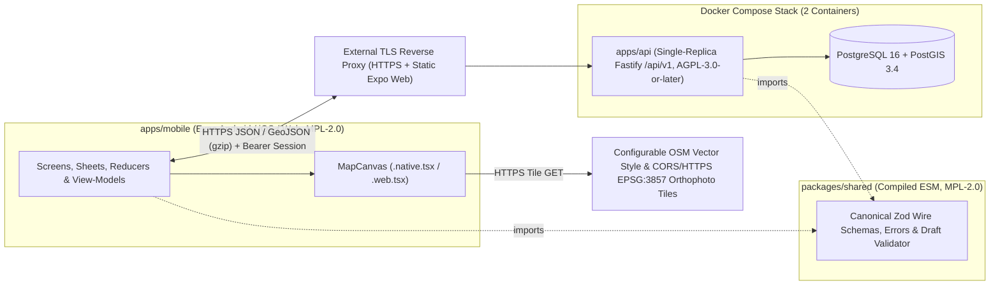

# Entsiegelungskartierung — Open-Source Ground-Unsealing PPGIS

*   **Author:** Unseal Contributors
*   **Status:** Approved
*   **Date:** 2026-11-12

--------------------------------------------------------------------------------

## Overview

**Entsiegelungskartierung** is an open-source Public Participation Geographic Information System (PPGIS — a map-based application for public spatial input) for Android, iOS, and Web. Citizens map impervious ground surfaces ("ground sealing", such as paved parking corners, concrete courtyards, and asphalt street margins) proposed for unsealing, and rank proposals with `+1` / `-1` votes.

This project is greenfield. It is structured as a Node 24 TypeScript monorepo (`packages/shared`, `apps/api`, `apps/mobile`, plus root end-to-end integration tests). A two-container Docker Compose stack (`PostgreSQL 16 + PostGIS 3.4` and `Fastify`) runs behind an external TLS reverse proxy in production. Unauthenticated visitors browse OpenStreetMap-based vector basemaps, toggle `EPSG:3857` aerial orthophotos (georectified aerial imagery), inspect proposals, and download GeoJSON exports without an account; contributors register no-email, pseudonymous accounts (unique `pseudonym`, password, and one-time recovery code) to submit proposals and vote.

## The Problem

Impervious ground surfaces block rainwater infiltration, intensify urban heat islands, and reduce urban habitat. Among surveyed open-source civic tools, **DIPAS** (Digitales Partizipationssystem, `https://dipas.org`) and **Mapsurvey** (`https://github.com/ganjasan/mapsurvey`) operate as browser web portals rather than native mobile apps, native field GIS apps such as **QField** and **Mergin Maps** target project-file surveyor workflows without anonymous public browsing or `+1 / -1` proposal voting, and **StreetComplete** edits OpenStreetMap tags directly rather than collecting candidate municipal unsealing proposals. Generic municipal form surveys record street addresses or single points instead of validated polygon boundaries (`m²`) exportable directly into desktop GIS tools such as QGIS.

Without aerial orthophotos layered beneath proposal geometries, citizens cannot reliably distinguish paved inner courtyards or asphalt margins from vegetated ground on vector street maps alone. Without topological validation (`ST_IsValidDetail`), vertex and span caps, and post-creation geometry immutability, crowd-sourced spatial datasets accumulate self-intersecting rings, continental sliver shapes, or boundary edits that reassign existing community votes to a different parcel; separately, unbounded viewport queries overload spatial read endpoints.

## Goals

*   **G1 — Anonymous map exploration, orthophoto toggle, and GIS export.** Unauthenticated users on Android, iOS, and Web can pan and zoom a configurable OpenStreetMap-data vector basemap (`osmStyleUrl`), toggle a server-configured `EPSG:3857` aerial orthophoto raster layer, center the map via permission-gated device GPS ("Locate me"), inspect proposal polygons (`surfaceType`, `note`, `areaM2`, `authorPseudonym`, `score`, `upvotes`, `downvotes`), and download all proposals as RFC 7946 GeoJSON via `GET /api/v1/polygons/export.geojson`.
*   **G2 — No-email, pseudonymous account lifecycle with self-service account deletion.** Users can register with a unique `pseudonym` (reserving `"deleted"` and `SHA-256` tombstones of deleted/banned names) and password, receiving a single-use 128-bit recovery code (`32` uppercase hex chars grouped as `8×4`) without providing an email address, phone number, or real name; authenticate via `SHA-256`-hashed opaque session bearer tokens; reset a forgotten password using their recovery code; and delete their account via `DELETE /api/v1/auth/me` so credentials, sessions, and the caller's votes are erased (recomputing affected polygon scores) while authored polygons remain public under `authorPseudonym: "deleted"`.
*   **G3 — Spatially validated polygon mapping (`>= 44 dp` touch controls).** Contributors can tap map vertices with live client-side geodesic area (`m²`) and crossed-edge/spike detection, undo vertices, close polygons (`3` to `200` distinct exterior vertices / `4` to `201` closed GeoJSON ring positions, `0` interior holes, polygon span `<= 0.05°`, geodesic area within `2 m²` to `500,000 m²`), attach `surfaceType` (`asphalt | concrete | pavers | other`) and optional `note` (`<= 500` characters), update `surfaceType`/`note` or delete their own polygons, and complete inline registration or re-authentication without losing an unsubmitted draft.
*   **G4 — Idempotent `+1 / -1` community rating.** Authenticated users can cast `+1` or `-1` on any polygon, flip their vote (`+1` to `-1` or `-1` to `+1`), or remove their vote, enforcing at most one active vote per `(polygon_id, user_id)` and updating `upvotes`, `downvotes`, and net `score` transactionally.
*   **G5 — Self-hostable open-source deployment and moderation CLI.** Operators can start PostgreSQL/PostGIS and the compiled Fastify API via `docker compose up`, apply deterministic numbered SQL migrations on container startup, configure map center/zoom, tile URLs, quotas, disclaimer text, and `abuseContact` via `.env` variables exposed on `GET /api/v1/config`, export static Expo Web assets (`npx expo export --platform web`), verify database/PostGIS readiness via `GET /api/v1/health`, and moderate abuse via `apps/api/src/cli/admin.ts`.

## Non-Goals

*   **NG1 — Photo or media uploads.** v1 excludes camera capture, file uploads, object storage (S3/MinIO), and image moderation.
*   **NG2 — Email collection, SMTP mail delivery, or third-party OAuth.** v1 stores no email addresses and requires no outbound mail server or external identity provider.
*   **NG3 — Post-creation polygon geometry editing.** Published polygon coordinates are immutable (`PATCH` modifies `surfaceType` and `note` only); changing a boundary requires deleting and redrawing the proposal so existing community votes cannot be reassigned to a different area.
*   **NG4 — Multi-criteria star ratings, comment threads, or pre-publication moderation queues.** v1 limits feedback to `+1 / -1` votes and an optional author `note` (`<= 500` characters).
*   **NG5 — Offline map tile packs, municipal geofence lockouts, or automatic polygon overlap merging.** Coordinates are open within `|lat| <= 85°` with configurable initial camera defaults; overlapping citizen proposals are permitted and inspected individually rather than merged automatically; tiles rely on standard HTTP caching.

## Resolved Decisions

*   **D1 — Monorepo, Compiled ESM Contracts & Wire Casing:** Node 24 TypeScript npm-workspaces monorepo (`packages/*`, `apps/*`) with ESM `"type": "module"`, `packages/shared` and `apps/api` compiled to `dist/` for NodeNext and Expo Metro compatibility, `camelCase` keys in all JSON/GeoJSON HTTP payloads (`surfaceType`, `areaM2`, `authorPseudonym`, `isAuthor`, `myVote`, `newPassword`, `recoveryCode`, `sessionToken`, `requestId`), and `snake_case` strictly in PostgreSQL columns.
*   **D2 — Platform-Neutral Map & Native Boundary:** Native MapLibre, secure storage, and GPS APIs on Android/iOS (`@maplibre/maplibre-react-native`, `expo-secure-store`, `expo-location`) and Web (`maplibre-gl`, `localStorage`, `navigator.geolocation`) are isolated behind `.native` and `.web` adapter modules, keeping reducers, style builders, and UI view-models pure TypeScript testable in Node without importing `react-native`.
*   **D3 — Runtime Map & Orthophoto Configuration (`GET /api/v1/config`):** Vector `osmStyleUrl` (defaulting to OpenFreeMap Liberty `https://tiles.openfreemap.org/styles/liberty`), optional `EPSG:3857` `orthophoto` raster config (`urlTemplate` supporting `{z}/{x}/{y}` XYZ and `{bbox-epsg-3857}` WMS templates, `tileSize: 256 | 512`, `attribution`, `bounds`, `maxZoom`), `initialView`, `limits`, `disclaimerText`, and `abuseContact` are served dynamically from `apps/api` with complete clean-checkout defaults.
*   **D4 — Zero-PII Pseudonymous Auth, 32-Hex Recovery Codes & Tombstoned Account Deletion:** Accounts store `pseudonym`, Argon2id PHC `password_hash`, and `SHA-256` `recovery_code_hash` (`16` CSPRNG bytes displayed as `32` uppercase hex chars `XXXX-XXXX-XXXX-XXXX-XXXX-XXXX-XXXX-XXXX`). Sessions use 256-bit bearer tokens (`30`-day TTL, max `10` active per user with oldest-session eviction) stored as `SHA-256` digests. Because zero out-of-band PII exists to verify ownership, operator password/recovery resets are excluded by design (losing both password and recovery code permanently locks the account). `DELETE /api/v1/auth/me` records a `SHA-256` tombstone of `LOWER(pseudonym)` in `reserved_pseudonyms` (blocking impersonation re-signup without retaining plaintext PII), deletes the `users` row, cascades `sessions` and `votes` (recomputing affected polygon scores under strict `users -> polygons` lock order), and sets `polygons.user_id = NULL` (`authorPseudonym: "deleted"`). Operator bans record tombstones and purge the banned account's polygons and votes.
*   **D5 — Single `optionalAuth` Viewport Read, `Vary: Authorization`, Unified `0.15°` Span Gate & Score Ordering:** `GET /api/v1/polygons?bbox=...` uses `optionalAuth` (emitting `Vary: Authorization`) to attach `myVote` and `isAuthor` directly on each GeoJSON feature (`myVote: 0, isAuthor: false` when anonymous), avoiding a second `/votes/mine` spatial query. Both client and server gate viewport fetches identically on `maxBboxSpanDeg = 0.15` (`~17 km` in latitude), and all viewport reads order matches by `score DESC, created_at DESC, id ASC` capped at `bboxFeatureLimit = 500`.
*   **D6 — Client Pre-Checks vs. Authoritative PostGIS Validation & CCW Winding:** Client drawing runs duplicate-tap deduplication, spike checks, `@turf/kinks`, and `@turf/area` on single exterior vertex rings for immediate UI feedback; server writes check ring structure and bounding-box span (`<= 0.05°`, `|lat| <= 85°`) in Zod and delegate topological validity (`ST_IsValidDetail`, `0` interior rings), ellipsoid area (`ST_Area(geom::geography)` in `[2, 500000]` m²), and RFC 7946 counter-clockwise normalization (`ST_ForcePolygonCCW`) to PostGIS.
*   **D7 — Split Open-Source Licensing & Root E2E Placement:** `apps/api` is licensed under `AGPL-3.0-or-later` (with an AGPLv3 §13 network-interaction notice in root `LICENSE`, `apps/api/LICENSE`, and `README.md` clarifying that `MPL-2.0` clients communicating with the HTTP API over a network remain covered by `MPL-2.0`), while `apps/mobile` and `packages/shared` are licensed under `MPL-2.0` for Apple App Store DRM compatibility. Full-stack HTTP E2E tests live at the monorepo root (`test/e2e-flow.test.ts`) so `apps/mobile` never depends on `apps/api`.

## Critical User Journeys (CUJs)

### CUJ 1: Anonymous Map Exploration, Orthophoto Toggle, and GeoJSON Export

*   **Given:** An unauthenticated visitor opens Entsiegelungskartierung on Android, iOS, or Web.
*   **When:** The client loads runtime configuration from `GET /api/v1/config` (showing a loading state or retry prompt before `RuntimeConfig` resolves), pans/zooms into a district (`bbox` span `<= 0.15°`) or taps "Locate me" to center on device GPS, toggles the aerial orthophoto layer on beneath proposal layers, and taps a rendered polygon (or triggers GeoJSON export).
*   **Then:** The app displays a dismissible first-visit `disclaimerText` banner (and keeps `disclaimerText` permanently visible inside the proposal inspector), renders proposals colored by net `score` (or shows `"Zoom in to view and add proposals"` when `bbox` span exceeds `0.15°`), cycles through deduplicated overlapping polygons (`1 / N`) in the bottom sheet displaying `surfaceType`, `note`, `areaM2`, `authorPseudonym`, `score`, `upvotes`, `downvotes`, and `abuseContact` without collecting or exposing email addresses, reverts `basemapMode` to `'osm'` with a warning banner if orthophoto tiles fail to load, and downloads all proposals via `GET /api/v1/polygons/export.geojson` (`Linking.openURL` on Android/iOS, anchor download on Web).

### CUJ 2: Inline Pseudonymous Registration and Validated Polygon Submission

*   **Given:** A visitor views a paved courtyard over the aerial orthophoto layer and taps "Draw Proposal".
*   **When:** The user taps `3` to `200` distinct exterior vertices on the map (using "Undo vertex" while watching live `m²` area and crossed-edge/spike feedback), taps "Close shape", selects `surfaceType` (`asphalt | concrete | pavers | other`) and optional `note`, and taps Submit; if unauthenticated (or if their session expired with `401 AUTH_REQUIRED`), an inline modal prompts registration/login without resetting the camera or draft, requires checking `"I have saved my recovery code"` on signup, refreshes viewport per-user flags, and automatically submits the deduplicated closed ring.
*   **Then:** Server checks ring structure (`4..201` closed positions, span `<= 0.05°`) and PostGIS `ST_IsValidDetail` + `ST_Area(geom::geography)` (`2 m²–500,000 m²`) + `ST_ForcePolygonCCW`; on `201 Created`, the new `PolygonFeature` renders on the map with `isAuthor: true`; if validation fails (`422`), the draft vertices and form inputs stay intact alongside the human-readable error reason.

### CUJ 3: Community `+1 / -1` Rating and Author Metadata Management

*   **Given:** An authenticated contributor opens an existing polygon in the bottom-sheet inspector.
*   **When:** The contributor taps `+1` (upvote), taps `-1` to flip their vote, or taps `-1` again to clear their vote; and, on a polygon where `isAuthor === true`, edits `surfaceType`/`note` or taps "Delete proposal".
*   **Then:** Vote mutations (`PUT` / `DELETE /api/v1/polygons/:id/vote`) lock the caller and target polygon row in global lock order, update `votes`, and recompute `upvotes`, `downvotes`, and `score` in a single transaction (`404 NOT_FOUND` if the polygon was deleted); `PATCH /api/v1/polygons/:id` updates `surfaceType` and/or `note` (`null` or `""` clears `note`) while rejecting any `geometry` property (`422`); `DELETE /api/v1/polygons/:id` deletes the polygon and cascades its `votes` (`403` if non-author, `404` if missing) without refunding the 24-hour creation quota.

### CUJ 4: Recovery-Code Password Reset and Tombstoned Account Deletion

*   **Given:** A registered contributor either forgot their password or selects "Delete Account" in account settings.
*   **When:** For recovery, they submit `{ pseudonym, recoveryCode, newPassword }` to `POST /api/v1/auth/recover`; for deletion, they confirm `DELETE /api/v1/auth/me`.
*   **Then:** Recovery verifies the `SHA-256` digest of the normalized 32-hex `recoveryCode`, updates `password_hash`, revokes all prior sessions, and returns a rotated `recoveryCode` + new `sessionToken`; account deletion locks the `users` row and affected `polygons` rows in global order, records the `SHA-256` tombstone of `LOWER(pseudonym)` in `reserved_pseudonyms`, deletes the `users` row (cascading `sessions` and `votes`), recomputes affected polygon vote totals, sets `polygons.user_id = NULL` (`authorPseudonym: "deleted"`), and refreshes the client viewport.

## Technical Plan (Architecture)

### 1. System Topology, Deployment Boundary, and Data Flow

*   **`packages/shared` (`MPL-2.0`):** Compiled ESM TypeScript package (`dist/`) exporting `camelCase` Zod request/response schemas (tolerating unknown future `surfaceType` strings on read via `.catch('other')` and using cross-platform `TextEncoder` for UTF-8 byte checks), `ErrorCode` + `ApiError`, and single-ring client draft geometry helpers (`@turf/area`, `@turf/kinks`).
*   **`apps/api` (`AGPL-3.0-or-later`):** Single-replica compiled Fastify `/api/v1` service (`HOST='0.0.0.0'`) with response compression (`@fastify/compress`), explicit `TRUST_PROXY` (`false` by default), configurable `CORS_ORIGIN`, `@fastify/rate-limit` (`global: false`, bounded LRU cache, IPv6 `/64` subnet normalization), Pino JSON logging (omitting client `remoteAddress` and redacting secrets), neutral bounded concurrency semaphores (`4`-slot Argon2id with `20`-queue and `2`-slot GeoJSON export), and `apps/api/src/cli/admin.ts`. Production deployments run behind an external TLS reverse proxy (Caddy/Nginx/Traefik) that terminates HTTPS (required for Web `navigator.geolocation` and mobile ATS/cleartext rules) and serves static `npx expo export --platform web` bundles.
*   **`apps/mobile` (`MPL-2.0`):** Expo SDK 52 application targeting Android, iOS, and Web (`EXPO_PUBLIC_API_BASE_URL` defaulting to `http://127.0.0.1:3000` in local dev). Map rendering, token storage, and geolocation live behind `.native` / `.web` adapters, while application state and UI view-models remain pure TypeScript.

### 2. Persistence Model, Lock Ordering, and Moderation (`PostgreSQL 16 + PostGIS 3.4`)

Numbered SQL migrations run on startup into `schema_migrations`:

*   **`users`:** `id UUID PRIMARY KEY`, `pseudonym TEXT NOT NULL` (unique index on `LOWER(pseudonym)`, `3..32` `[a-zA-Z0-9_-]`, rejecting `"deleted"` case-insensitively), `password_hash TEXT NOT NULL` (Argon2id PHC string; passwords `8..128` chars and `<= 1024` UTF-8 bytes), `recovery_code_hash BYTEA NOT NULL` (`SHA-256` of 32-char uppercase hex recovery code), `created_at TIMESTAMPTZ NOT NULL DEFAULT NOW()`.
*   **`reserved_pseudonyms`:** `pseudonym_hash BYTEA PRIMARY KEY` (`SHA-256` of `LOWER(pseudonym)`), `reason TEXT NOT NULL` (`'self_deleted'` or ban reason), `created_at TIMESTAMPTZ NOT NULL DEFAULT NOW()`. Checked at registration (`403 FORBIDDEN_PSEUDONYM_BANNED` when `reason !== 'self_deleted'`, `409 AUTH_PSEUDONYM_TAKEN` when `'self_deleted'` or `"deleted"`), blocking impersonation of deleted or banned contributors without storing plaintext PII.
*   **`sessions`:** `id UUID PRIMARY KEY`, `user_id UUID NOT NULL REFERENCES users(id) ON DELETE CASCADE` (indexed), `token_hash BYTEA UNIQUE NOT NULL` (`SHA-256` of 32-byte random bearer token), `expires_at TIMESTAMPTZ NOT NULL` (`30`-day TTL), `created_at TIMESTAMPTZ NOT NULL DEFAULT NOW()`. Capped at `10` active sessions per user by evicting oldest rows on login/register.
*   **`polygons` & `polygon_creations`:** `polygons` stores `id UUID PRIMARY KEY`, `user_id UUID REFERENCES users(id) ON DELETE SET NULL`, `geom GEOMETRY(Polygon, 4326) NOT NULL` (`x = lng, y = lat`, GiST index `idx_polygons_geom`), `surface_type TEXT NOT NULL` (`TEXT` rather than PostgreSQL `ENUM` for additive schema evolution), `note TEXT`, `area_m2 DOUBLE PRECISION NOT NULL`, `upvotes INTEGER NOT NULL DEFAULT 0`, `downvotes INTEGER NOT NULL DEFAULT 0`, `score INTEGER NOT NULL DEFAULT 0`, `created_at TIMESTAMPTZ NOT NULL DEFAULT NOW()`, `updated_at TIMESTAMPTZ NOT NULL DEFAULT NOW()`, plus B-tree indexes `idx_polygons_user_created (user_id, created_at DESC)`, `idx_polygons_score_created (score DESC, created_at DESC, id ASC)`, and `idx_polygons_created_id (created_at ASC, id ASC)`. `polygon_creations` (`id BIGSERIAL PRIMARY KEY`, `user_id UUID NOT NULL REFERENCES users(id) ON DELETE CASCADE`, `created_at TIMESTAMPTZ NOT NULL DEFAULT NOW()`, indexed on `(user_id, created_at DESC)`) records creation events so deleting a downvoted proposal does not reset the `25 polygons / 24h` quota. PostGIS validation runs in API write queries rather than table `CHECK` constraints for safe `pg_restore` portability.
*   **`votes` & Global Lock Order:** `votes` stores `(polygon_id, user_id)` `PRIMARY KEY` (`ON DELETE CASCADE` on both FKs, `value SMALLINT IN (-1, 1)`, `idx_votes_user_id`). All write and deletion transactions enforce a strict global lock order (**`users` before `polygons` ordered by `polygons.id ASC`**): polygon/vote writes lock `users` `FOR KEY SHARE` before locking `polygons` `FOR UPDATE`, while `DELETE /api/v1/auth/me` and `ban-user` lock `users` `FOR UPDATE` first before reading `votes`, locking affected `polygons` `FOR UPDATE` in `id` order, deleting `users`, and recomputing vote totals in one shared integrity helper.
*   **Operator Moderation CLI (`apps/api/src/cli/admin.ts`):** Supports `ban-user <pseudonym> [reason]` (inserts `SHA-256(LOWER(pseudonym))` into `reserved_pseudonyms` even preemptively when no `users` row exists; if a `users` row exists, deletes their polygons and votes and recomputes affected polygon scores), `delete-polygon <id>`, and `redact-note <id>` (sets `note = NULL`).

### 3. Versioned HTTP API Contract (`/api/v1`)

Responses carry `x-request-id` and return `camelCase` JSON (or compressed `application/geo+json`); errors return `{ error: { code, message, details?, requestId } }`:

| Endpoint | Auth & Rate Limit | Semantics |
| :--- | :--- | :--- |
| `GET /api/v1/health` | Public | Returns `200 { status: "ok", postgisVersion, migrationsApplied }` when all migration files are applied, else `503 SERVICE_UNAVAILABLE`. |
| `GET /api/v1/config` | Public | Returns `{ osmStyleUrl, orthophoto: { urlTemplate, tileSize, attribution, bounds, maxZoom } \| null, initialView: { lng, lat, zoom }, limits: { minAreaM2, maxAreaM2, maxVertices, maxPolygonSpanDeg, maxBboxSpanDeg, bboxFeatureLimit, maxDailyPolygonsPerUser }, disclaimerText, abuseContact: string \| null }`. |
| `POST /api/v1/auth/register` | Public (`10/hr/IP-subnet`) | Rejects `"deleted"`, tombstoned/banned, or active pseudonyms (`409` / `403`); hashes password via Argon2id semaphore (`503 AUTH_BUSY` on queue overflow); returns `201 { user, sessionToken, expiresAt, recoveryCode }`. |
| `POST /api/v1/auth/login` | Public (`20/15m/IP-subnet` & `5/15m/(IP-subnet, pseudonym)`) | Runs dummy Argon2id verify on unknown pseudonym via Argon2id semaphore (`503 AUTH_BUSY` on overflow); returns `200 { user, sessionToken, expiresAt }` or `401 AUTH_INVALID_CREDENTIALS` / `429 RATE_LIMITED`. |
| `POST /api/v1/auth/recover` | Public (`10/15m/IP-subnet`) | Body `{ pseudonym, recoveryCode, newPassword }`; verifies `SHA-256` of normalized 32-hex `recoveryCode`, hashes `newPassword` via Argon2id semaphore (`503 AUTH_BUSY`), revokes sessions, rotates and returns `200 { user, sessionToken, expiresAt, recoveryCode }` or `401 AUTH_RECOVERY_INVALID`. |
| `POST /api/v1/auth/logout` | Bearer Session | Deletes current `sessions` row (`204 No Content`). |
| `GET /api/v1/auth/me` | Bearer Session | Returns `200 { id, pseudonym, createdAt }`. |
| `DELETE /api/v1/auth/me` | Bearer Session (`10/hr/IP-subnet`) | Locks `users` then voted `polygons` in global order, tombstones `SHA-256(LOWER(pseudonym))`, deletes `users` (cascading `sessions` & `votes`, setting `polygons.user_id = NULL`), and recomputes affected polygon scores (`204 No Content`). |
| `GET /api/v1/polygons` | Optional Bearer | Query `?bbox=minLng,minLat,maxLng,maxLat` (`422 VALIDATION_ERROR` if malformed, `422 BBOX_TOO_LARGE` if span `> 0.15°`). Orders intersecting polygons (`6`-decimal `ST_AsGeoJSON`) by `score DESC, created_at DESC, id ASC` up to `500`, returning `{ type: "FeatureCollection", features: PolygonFeature[], meta: { truncated: boolean, limit: 500 } }`. Emits `Vary: Authorization` and `Cache-Control: no-store` when `Authorization` is present, else `public, max-age=5`. |
| `GET /api/v1/polygons/export.geojson` | Public (`6/min/IP-subnet`) | Streams RFC 7946 `FeatureCollection` (`PolygonFeature[]` with `myVote: 0, isAuthor: false`, `Content-Disposition: attachment`) inside a read-only transaction (`10 s` statement timeout, `30 s` stream wall-clock timeout, max `2` concurrent exports -> `503 SERVICE_UNAVAILABLE`). |
| `GET /api/v1/polygons/:id` | Optional Bearer | Validates UUID `:id`; emits `Vary: Authorization` (`no-store` if authenticated, else `public, max-age=5`); returns `200 PolygonFeature` or `404 NOT_FOUND`. |
| `POST /api/v1/polygons` | Bearer Session (`30/min/IP-subnet`) | Body `{ geometry, surfaceType, note? }`; enforces `25` creations/24h/user via `polygon_creations` (`429 RATE_LIMITED`), checks closed ring (`4..201` positions, `0` holes, span `<= 0.05°`, `|lat| <= 85°`), validates PostGIS `ST_IsValidDetail` + `ST_Area` (`2..500,000 m²`) + `ST_ForcePolygonCCW`, returns `201 PolygonFeature` (`422 GEOMETRY_INVALID` / `AREA_OUT_OF_BOUNDS`). |
| `PATCH /api/v1/polygons/:id` | Bearer Author (`30/min/IP-subnet`) | Body `{ surfaceType?, note? }` (rejecting `geometry` with `422`); returns `200 PolygonFeature`, `403 FORBIDDEN_NOT_AUTHOR`, or `404 NOT_FOUND`. |
| `DELETE /api/v1/polygons/:id` | Bearer Author (`30/min/IP-subnet`) | Deletes author's polygon and cascades `votes` (`204 No Content`, `403 FORBIDDEN_NOT_AUTHOR`, or `404 NOT_FOUND`). |
| `PUT /api/v1/polygons/:id/vote` | Bearer Session (`60/min/IP-subnet`) | Body `{ value: 1 \| -1 }`; locks user (`FOR KEY SHARE`) and polygon (`FOR UPDATE`), upserts vote, updates counters, returns `200 { polygonId, upvotes, downvotes, score, myVote }` or `404 NOT_FOUND`. |
| `DELETE /api/v1/polygons/:id/vote` | Bearer Session (`60/min/IP-subnet`) | Locks user and polygon, deletes caller's vote, updates counters, returns `200 { polygonId, upvotes, downvotes, score, myVote: 0 }` or `404 NOT_FOUND`. |

### 4. Client Map Boundary and State Separation (`apps/mobile`)

`apps/mobile` separates rendering/platform APIs from pure state management:

*   **Platform Adapters:** `MapCanvas.native.tsx` (`@maplibre/maplibre-react-native`) and `MapCanvas.web.tsx` (`maplibre-gl` + `maplibre-gl.css`) implement `MapCanvasProps` with deterministic layer z-ordering (`basemap` -> `orthophoto` raster beneath proposals -> `proposals-fill` / `proposals-outline` / `proposals-centroid` -> `draft-fill` / `draft-line` / `draft-vertices`), `properties.id` promotion for Web hit-testing, orthophoto-filtered tile errors, and deduplicated multi-feature tap queries. `secureStorage.{native,web}.ts` (`expo-secure-store` on native, `localStorage` with memory fallback on Web) and `locateMe.{native,web}.ts` implement async `SessionStorage` and GPS adapters.
*   **Pure Reducers & View-Models:** Application reducers manage cold-start config loading (`loading | ready | error`), `maxBboxSpanDeg` gating, overlapping-polygon cycling, closed/open draft ring transitions, viewport refreshes on login/logout/account-deletion, and `pendingIntent` continuation across anonymous signup and `401` session expiration.

## Alternatives Considered

### Alternative A: Web/PWA-Only (`maplibre-gl`) or Capacitor WebView

*   **Pros:** Maintains one browser map engine (`maplibre-gl`), avoids native mobile build pipelines, and distributes directly via browser URLs without app store developer accounts.
*   **Cons:** Does not provide native Android and iOS map rendering or native store distribution, and wraps mobile touch gestures inside a system WebView rather than native MapLibre views.
*   **Reason for Rejection:** Rejected by author — native Android and iOS applications are a primary project requirement, and isolating MapLibre behind a two-file `MapCanvas` adapter retains Expo Web support alongside native builds.

### Alternative B: Flutter (`flutter_map` / Dart) or FastAPI (Python) Backend

*   **Pros:** Flutter compiles ahead-of-time native mobile UIs; Python FastAPI integrates with `Shapely` and `GeoAlchemy2`.
*   **Cons:** Splitting client and server across Dart/TypeScript and Python duplicates GeoJSON validation rules, wire DTO definitions, and test suites across two ecosystems.
*   **Reason for Rejection:** Rejected by author — a single Node 24 TypeScript monorepo shares canonical Zod schemas and draft geometry validators directly between `apps/api` and `apps/mobile`.

### Alternative C: Self-Hosted Supabase, Browser Portals (`DIPAS`, `Mapsurvey`), or Native Field GIS (`QField`, `Mergin Maps`, `StreetComplete`)

*   **Pros:** Supabase bundles PostgreSQL, GoTrue, Envoy/Kong, and PostgREST; DIPAS and Mapsurvey provide browser participation portals; QField, Mergin Maps, and StreetComplete are mature native mobile mapping apps.
*   **Cons:** DIPAS and Mapsurvey lack native Android/iOS mobile apps; QField and Mergin Maps center on project-file surveyor sync without anonymous public browsing or `+1 / -1` voting; StreetComplete edits OpenStreetMap directly; and default self-hosted Supabase Docker Compose runs an 11-container stack rather than a 2-container (`Fastify` + `PostGIS`) stack behind an operator reverse proxy.
*   **Reason for Rejection:** Rejected by author — a 2-container Fastify + PostGIS Compose stack keeps custom recovery-code auth, tombstoned account deletion, and PostGIS voting endpoints in one lightweight repository.

### Alternative D: Email + Dual JWT Rotation or WebAuthn Passkeys

*   **Pros:** Email + JWT is widely familiar; WebAuthn Passkeys / client cryptographic keypairs avoid server-side Argon2id hashing and password lockouts.
*   **Cons:** Without an SMTP server in v1, stored email addresses add direct contact PII to store and protect without enabling password reset; dual JWT rotation delays revocation compared to an indexed `sessions` lookup on an existing PostgreSQL pool; WebAuthn Passkeys require HTTPS relying-party domain binding (`apple-app-site-association` / Android `assetlinks.json`) that complicates self-hosted municipal deployments, while unbacked local keypairs are lost on device replacement.
*   **Reason for Rejection:** Rejected by author — `pseudonym` + Argon2id password + `SHA-256`-hashed 32-hex recovery code + PostgreSQL session tokens work on any self-hosted domain without SMTP or Apple/Google domain-verification files while supporting immediate revocation.

### Alternative E: Multi-Criteria Ratings, Structured-Only Tags (No Free-Text `note`), or Mutable Geometry

*   **Pros:** Multi-criteria scores capture finer gradations; restricting proposals strictly to predefined tags (removing `note`) eliminates free-text PII/defamation moderation risk; editable vertices allow post-publish boundary tweaks.
*   **Cons:** Multi-criteria forms add mobile tap friction; omitting `note` prevents citizens from recording site-specific context (e.g., `"unused overflow lot behind library, floods in summer rain"`); mutable post-vote geometry allows moving existing `+1` support onto a different site.
*   **Reason for Rejection:** Rejected by author — `+1 / -1` voting, `surfaceType` + optional `<= 500`-char `note` (backed by `abuseContact` and `admin.ts redact-note`), and immutable post-creation geometry balance field utility with vote integrity.

### Alternative F: Uniform `AGPL-3.0-or-later` Across All Monorepo Packages

*   **Pros:** Single license across server, shared library, and mobile client.
*   **Cons:** Standard `AGPL-3.0-or-later` terms conflict with Apple App Store digital-rights-management distribution terms once external contributors hold copyright in iOS client code.
*   **Reason for Rejection:** Rejected by author — licensing `apps/api` as `AGPL-3.0-or-later` (with an AGPLv3 §13 network-interaction clarification in `LICENSE`, `apps/api/LICENSE`, and `README.md`) and `apps/mobile` + `packages/shared` as `MPL-2.0` preserves server copyleft while avoiding Apple App Store DRM conflicts on client binaries.

--------------------------------------------------------------------------------

## Risks

*   **R1 — Sybil account creation, vote brigading, targeted contributor lockouts, and polygon/sliver spam.** Without identity verification, scripts could register disposable pseudonyms, submit continental slivers, launder downvoted proposals by deleting and recreating them, or probe public author pseudonyms to trigger lockouts. *Mitigation:* Normalize IPv6 rate-limit keys to `/64`; enforce `10/hr/IP-subnet` registration limits and composite `5/15m/(IP-subnet, pseudonym)` login limits (preventing third-party global lockouts of public authors); cap polygons to `<= 0.05°` bounding-box span; count creations against `polygon_creations` (`25/24h` non-refundable on delete); cascade caller votes on `DELETE /api/v1/auth/me` under strict `users -> polygons` lock order; and provide `admin.ts ban-user`. Duplicate overlapping proposals splitting votes and manual brigading without identity checks are accepted v1 trade-offs.
*   **R2 — External vector basemap and municipal WMS/XYZ orthophoto rate limits, outages, or Web CORS blocks.** OSM Foundation raster servers prohibit bulk app usage, and municipal WMS servers may throttle requests or omit browser CORS headers on Expo Web. *Mitigation:* Default `osmStyleUrl` to OpenFreeMap (`https://tiles.openfreemap.org/styles/liberty`), document self-hosted `PMTiles` and reverse-proxy CORS routing for municipal `EPSG:3857` XYZ/WMS orthophotos in `README.md`, constrain fetches via `bounds`, `maxZoom`, and `tileSize`, allow URL rollback without client rebuilds via `GET /api/v1/config`, and revert `basemapMode` to `'osm'` when orthophoto tiles error.
*   **R3 — CPU/RAM exhaustion from Argon2id bursts, large GeoJSON payloads, or slow-reader export streams.** Concurrent Argon2id hashes, uncompressed coordinate payloads, or stalled TCP readers can pressure a `512 MiB` single-replica API container. *Mitigation:* Gate Argon2id operations behind a `4`-slot / `20`-queue semaphore (`503 AUTH_BUSY`), hash 128-bit recovery codes with `SHA-256`, cap request bodies at `64 KiB` (`413 PAYLOAD_TOO_LARGE`) and exterior vertices at `<= 200` (`4..201` closed ring positions), round `ST_AsGeoJSON` output to `6` decimal places with gzip/brotli compression, bound viewport spans to `<= 0.15°` (`500` features), and guard `export.geojson` with a `2`-slot semaphore (`503 SERVICE_UNAVAILABLE`), `10 s` read-only transaction statement timeout, and `30 s` wall-clock stream timeout.
*   **R4 — Permanent account lockout if a user loses both password and recovery code.** Because accounts store zero email/phone PII and `authorPseudonym` is public, operator-initiated recovery resets are excluded to prevent social-engineering takeovers; losing both credentials permanently locks that pseudonym. *Mitigation:* Gate closing the post-signup modal on `"I have saved my recovery code"` and configure password-manager autofill hints on registration, login, and recovery inputs.
*   **R5 — Personal data handling, third-party PII in `note`, or misinterpretation of citizen proposals.** User-linked pseudonyms and in-memory client IPs are personal data processed by design under GDPR, while citizens might mistakenly enter third-party personal data into `note` or mistake proposals on private courtyards for municipal decrees. *Mitigation:* Omit `remoteAddress` from Pino logs (and document disabling reverse-proxy IP access logs in `README.md`), tombstone deleted pseudonyms as `SHA-256` digests, cap `note` at `500` characters, show a dismissible first-visit `disclaimerText` banner plus a permanent `disclaimerText` notice and `abuseContact` inside the inspector sheet, and support operator CLI redaction via `admin.ts redact-note <id>` and `delete-polygon <id>`.
*   **R6 — Native MapLibre build maintenance, Web XSS token exposure, and store fees.** `@maplibre/maplibre-react-native` requires custom native builds (`expo prebuild`), Web `localStorage` tokens require XSS hygiene, and public app stores charge developer fees. *Mitigation:* Pin Expo SDK 52 and MapLibre behind `MapCanvas.{native,web}.tsx`, document recommended reverse-proxy Content-Security-Policy (CSP) headers for Expo Web in `README.md`, keep automated tests runnable in Node without mobile simulators, and ship Expo Web alongside Android/iOS builds.

## Non-Functional Requirements

*   **Performance, Compression & Single-Replica Scope:** `apps/api` runs as a single replica in v1 (in-memory rate-limit LRU caches and concurrency semaphores are per-process). `GET /api/v1/polygons?bbox=...` (`span <= 0.15°`, `500` features max, `6`-decimal GeoJSON coordinates, gzip/brotli compressed) targets `< 150 ms` p95 at `20 RPS` with `10,000` stored polygons on a 2-vCPU PostGIS instance; HTTP request bodies are capped at `64 KiB`; polygons are capped at `200` distinct exterior vertices (`<= 0.05°` span); client viewport pan requests are debounced (`250 ms` after camera settle).
*   **Security, TLS & Log Redaction:** Passwords (`8..128` chars, `<= 1024` UTF-8 bytes) are hashed with Argon2id (`memoryCost: 19456 KiB`, `timeCost: 2`, `parallelism: 1`) as PHC strings; 128-bit recovery codes (`32` uppercase hex chars) and 256-bit session bearer tokens (`30`-day TTL) are stored as `SHA-256` `BYTEA` digests; Pino omits `remoteAddress` and redacts `authorization` headers, passwords, recovery codes, and session tokens; production traffic runs behind TLS with explicit `TRUST_PROXY`, `CORS_ORIGIN`, and `Vary: Authorization` caching headers.
*   **Backward Compatibility & Rollback:** All routes use `/api/v1`; SQL migrations are additive (`surface_type` as `TEXT`, no PostGIS function `CHECK` constraints); `packages/shared` response schemas tolerate unknown JSON properties and coerce unknown `surfaceType` strings to `'other'`.
*   **Operations & Observability:** `GET /api/v1/health` checks PostgreSQL connectivity, `PostGIS_Version()`, and full migration application for Docker Compose `fetch` healthchecks; every API response carries `x-request-id`; `.env.example` and `README.md` document `.env` configuration, `PMTiles` / WMS CORS proxy setup, Web CSP headers, and `pg_dump` backups.

--------------------------------------------------------------------------------

### Additional Resources

*   RFC 7946 — The GeoJSON Format (`https://datatracker.ietf.org/doc/html/rfc7946`, WGS 84 `urn:ogc:def:crs:OGC::CRS84` `[lng, lat]` coordinate order and counter-clockwise exterior ring right-hand rule).
*   PostGIS 3.4 Documentation — `ST_IsValidDetail`, `ST_Area(geography)`, `ST_ForcePolygonCCW`, and GiST Spatial Indexing (`https://postgis.net/docs/`).
*   DIPAS (`https://dipas.org`), Mapsurvey (`https://github.com/ganjasan/mapsurvey`), QField (`https://qfield.org`), and OpenFreeMap (`https://openfreemap.org`).
*   OWASP Password Storage Cheat Sheet — Argon2id parameter guidance.

### Future Improvements

*   Optional ground-level photo attachments per proposal backed by S3-compatible storage and pre-display moderation.
*   Optional server-configured municipal boundary polygon (`ST_Within` geofence) for city-sponsored campaigns.
*   Low-zoom server-side spatial clustering (`ST_ClusterDBSCAN` or vector MVT tiles) and Redis-backed rate limiting when multi-replica deployments exceed `50,000` polygons.
*   In-app community abuse-flagging endpoint (`POST /api/v1/polygons/:id/report`) with configurable auto-hide thresholds.
*   Optional WebAuthn / Passkey sign-in for HTTPS deployments with configured Apple/Android domain associations.

--------------------------------------------------------------------------------

## Detailed Implementation Plan

### Goal

*   **Goal:** Deliver the open-source Entsiegelungskartierung PPGIS TypeScript monorepo (`packages/shared`, `apps/api` Fastify + PostGIS, `apps/mobile` Expo + MapLibre Native/Web adapter, and root E2E suite) supporting anonymous map/orthophoto inspection, streamed GeoJSON export, pseudonymous account lifecycle with 32-hex recovery codes and tombstoned author-anonymizing deletion, validated polygon mapping, and `+1 / -1` community voting.
*   **Outcome:** `npm run build && npm run typecheck && npm test`

### Task PPGIS-1: Bootstrap Compiled ESM Monorepo, Split Licensing, Shared Schemas, and Draft Validator

*   **Files:** `package.json` (Create), `package-lock.json` (Create), `tsconfig.base.json` (Create), `.gitignore` (Create), `LICENSE` (Create), `packages/shared/LICENSE` (Create), `packages/shared/package.json` (Create), `packages/shared/tsconfig.json` (Create), `packages/shared/src/constants.ts` (Create), `packages/shared/src/errors.ts` (Create), `packages/shared/src/schemas.ts` (Create), `packages/shared/src/geometry.ts` (Create), `packages/shared/src/index.ts` (Create), `packages/shared/test/shared.test.ts` (Create)
*   **Depends on:** none
*   **Called by:** `packages/shared/src/index.ts`
*   **Symbols:** `SURFACE_TYPES`, `SurfaceType`, `GEOMETRY_LIMITS`, `AUTH_LIMITS`, `RESERVED_PSEUDONYMS`, `ErrorCode`, `ApiError`, `ApiErrorEnvelopeSchema`, `RegisterRequestSchema`, `LoginRequestSchema`, `RecoverRequestSchema`, `AuthUserSchema`, `RegisterResponseSchema`, `SessionResponseSchema`, `HealthResponseSchema`, `RuntimeConfig`, `RuntimeConfigSchema`, `UuidParamSchema`, `CreatePolygonRequestSchema`, `PatchPolygonRequestSchema`, `VoteRequestSchema`, `VoteResponseSchema`, `PolygonFeature`, `PolygonFeatureSchema`, `PolygonCollectionResponseSchema`, `BboxQuerySchema`, `checkBboxSpan`, `normalizeRecoveryCode`, `checkPolygonRingStructure`, `DraftValidationResult`, `dedupeConsecutivePoints`, `closeRingIfNeeded`, `validateDraftPolygon`
*   **Changes:** Create root `package.json` (`"private": true`, `"type": "module"`, `"engines": { "node": ">=24.0.0" }`, `"workspaces": ["packages/*", "apps/*"]`, `"scripts": { "build": "npm --workspace packages/shared run build && npm --workspaces --if-present run build", "typecheck": "npm --workspace packages/shared run build && npm --workspaces --if-present run typecheck", "test": "npm --workspace packages/shared run build && npm --workspaces --if-present test" }`, devDependencies `typescript@^5.6.3`, `tsx@^4.19.2`, `@types/node@^22.9.0`), `tsconfig.base.json` (`target: "ES2023"`, `module: "NodeNext"`, `moduleResolution: "NodeNext"`, `strict: true`, `noUncheckedIndexedAccess: true`, `declaration: true`, `skipLibCheck: true`), `.gitignore` (`node_modules`, `dist`, `.env`, `.expo`, `web-build`), root `LICENSE` (`AGPL-3.0-or-later` text + AGPLv3 §13 notice clarifying that `MPL-2.0` client packages communicating with the HTTP API over a network remain covered by `MPL-2.0`), `packages/shared/LICENSE` (`MPL-2.0` full license text), `packages/shared/tsconfig.json` (extending `../../tsconfig.base.json` with `"rootDir": "src"`, `"outDir": "dist"`, `"include": ["src/**/*.ts"]`), and `packages/shared/package.json` (`"name": "@entsiegelung/shared"`, `"type": "module"`, `"main": "./dist/index.js"`, `"types": "./dist/index.d.ts"`, `"exports": { ".": { "types": "./dist/index.d.ts", "default": "./dist/index.js" } }`, `"files": ["dist", "LICENSE"]`, scripts `"build": "tsc -p tsconfig.json"`, `"typecheck": "tsc -p tsconfig.json --noEmit"`, `"test": "node --import tsx --test"`, dependencies `zod@^3.23.8`, `@turf/area@^7.1.0`, `@turf/kinks@^7.1.0`, `@turf/helpers@^7.1.0`). Implement `constants.ts` (`SURFACE_TYPES = ['asphalt', 'concrete', 'pavers', 'other'] as const`; `GEOMETRY_LIMITS = { MIN_AREA_M2: 2, MAX_AREA_M2: 500_000, MIN_VERTICES: 3, MAX_VERTICES: 200, MIN_RING_POSITIONS: 4, MAX_RING_POSITIONS: 201, MAX_POLYGON_SPAN_DEG: 0.05, MAX_ABS_LAT: 85, MAX_BBOX_SPAN_DEG: 0.15, BBOX_FEATURE_LIMIT: 500, DEDUPE_EPSILON_DEG: 1e-7, MIN_TURN_ANGLE_DEG: 2, MAX_NOTE_LENGTH: 500 }`; `AUTH_LIMITS = { PSEUDONYM_REGEX: /^[a-zA-Z0-9_-]{3,32}$/, MIN_PASSWORD_LENGTH: 8, MAX_PASSWORD_LENGTH: 128, MAX_PASSWORD_BYTES: 1024, RECOVERY_CODE_BYTES: 16, RECOVERY_CODE_HEX_LENGTH: 32, SESSION_TTL_DAYS: 30, MAX_SESSIONS_PER_USER: 10 }`; `RESERVED_PSEUDONYMS = ['deleted'] as const`). Implement `errors.ts` with `ErrorCode` (`'AUTH_REQUIRED' | 'AUTH_INVALID_CREDENTIALS' | 'AUTH_PSEUDONYM_TAKEN' | 'FORBIDDEN_PSEUDONYM_BANNED' | 'AUTH_RECOVERY_INVALID' | 'AUTH_BUSY' | 'FORBIDDEN_NOT_AUTHOR' | 'NOT_FOUND' | 'VALIDATION_ERROR' | 'GEOMETRY_INVALID' | 'AREA_OUT_OF_BOUNDS' | 'BBOX_TOO_LARGE' | 'PAYLOAD_TOO_LARGE' | 'RATE_LIMITED' | 'SERVICE_UNAVAILABLE' | 'INTERNAL_ERROR'`), `ApiError(statusCode, code, message, details?)`, and `ApiErrorEnvelopeSchema`. Implement `schemas.ts` in `camelCase` using `new TextEncoder().encode(password).byteLength <= 1024` (never Node `Buffer` so Hermes and browsers work natively): `normalizeRecoveryCode(input)` (`input.replace(/[-\s]/g, '').toUpperCase()`), `RegisterRequestSchema` & `LoginRequestSchema` (`{ pseudonym, password }`), `RecoverRequestSchema` (`{ pseudonym, recoveryCode: z.string().min(1).max(128), newPassword }`), `AuthUserSchema` (`{ id, pseudonym, createdAt }`), `RegisterResponseSchema` (`{ user, sessionToken, expiresAt, recoveryCode }`), `SessionResponseSchema` (`{ user, sessionToken, expiresAt }`), `HealthResponseSchema` (`{ status: z.literal('ok'), postgisVersion: z.string(), migrationsApplied: z.number().int().min(1) }`), `RuntimeConfigSchema`, `UuidParamSchema`, `CreatePolygonRequestSchema` (`{ geometry: { type: 'Polygon', coordinates }, surfaceType, note?: string | null }` `.strict()` calling `checkPolygonRingStructure` to require `coordinates.length === 1` (`0` interior holes), `4..201` finite positions with `|lng| <= 180` and `|lat| <= 85`, closed `first === last`, and ring span `maxLng - minLng <= 0.05` & `maxLat - minLat <= 0.05`), `PatchPolygonRequestSchema` (`{ surfaceType?, note?: string | null }` `.strict()` requiring `>= 1` key and rejecting `geometry`), `VoteRequestSchema` (`{ value: z.union([z.literal(1), z.literal(-1)]) }`), `VoteResponseSchema` (`{ polygonId, upvotes, downvotes, score, myVote }`), `BboxQuerySchema` (syntax + `minLng < maxLng` & `minLat < maxLat` -> `422 VALIDATION_ERROR`) + `checkBboxSpan(bbox)` (throwing `ApiError(422, 'BBOX_TOO_LARGE', ...)` when `maxLng - minLng > 0.15` or `maxLat - minLat > 0.15`), `PolygonFeatureSchema` (`{ type: 'Feature', id: z.string().uuid(), geometry, properties: { id: z.string().uuid(), surfaceType: z.enum(SURFACE_TYPES).catch('other'), note: z.string().nullable(), areaM2, authorPseudonym, upvotes, downvotes, score, myVote, isAuthor, createdAt, updatedAt } }` ignoring extra keys), and `PolygonCollectionResponseSchema` (`{ type: 'FeatureCollection', features: z.array(PolygonFeatureSchema), meta: { truncated: z.boolean(), limit: z.number().int() } }`). Implement `geometry.ts`: `dedupeConsecutivePoints(vertices: [number, number][], eps = 1e-7)`, `closeRingIfNeeded(vertices: [number, number][])`, `checkPolygonRingStructure(coordinates: number[][][])`, and `validateDraftPolygon(vertices: [number, number][]): DraftValidationResult` (`{ valid: boolean, closedRing: [number, number][] | null, vertexCount: number, areaM2: number, nearAreaBound: boolean, crossingPoint: [number, number] | null, errors: string[] }` checking `3..200` distinct vertices after dedup, `|lat| <= 85`, span `<= 0.05°`, interior turn-back angle `< 2°` spikes, `@turf/kinks` crossings, and `@turf/area` in `[2, 500_000] m²`). Install dependencies to generate `package-lock.json`.
*   **Verification:** `npm --workspace packages/shared run build && npm --workspace packages/shared run typecheck && npm --workspace packages/shared test -- test/shared.test.ts`
*   **Review focus:**
    1.  `validateDraftPolygon` deduplicates consecutive taps within `1e-7°`, accepts a valid 4-vertex courtyard (`~120 m²`), and flags `< 3` or `> 200` distinct vertices, `> 0.05°` sliver spans, `< 2°` fold-back spikes (`A -> B -> A`), bow-tie crossings (`crossingPoint`), and areas `< 2 m²` or `> 500,000 m²`; `CreatePolygonRequestSchema` rejects multi-ring polygons with interior holes.
    2.  `PatchPolygonRequestSchema` rejects empty `{}` and `{ geometry: ... }`; `RegisterRequestSchema` uses `TextEncoder` (zero `Buffer` reference) to reject `< 8`-char or `> 1024`-byte passwords; `PolygonFeatureSchema` coerces unknown `surfaceType: "cobblestone_v2"` to `"other"`.
    3.  `BboxQuerySchema` rejects malformed/inverted bounds with `ZodError`, while `checkBboxSpan` throws `ApiError(422, 'BBOX_TOO_LARGE')` on spans `> 0.15°`.

### Task PPGIS-2: Docker Compose PostGIS Stack, Compiled API Build, SQL Migrations, Health, and Runtime Config

*   **Files:** `.dockerignore` (Create), `docker-compose.yml` (Create), `.env.example` (Create), `package-lock.json` (Modify), `apps/api/LICENSE` (Create), `apps/api/package.json` (Create), `apps/api/tsconfig.json` (Create), `apps/api/Dockerfile` (Create), `apps/api/migrations/001_initial_schema.sql` (Create), `apps/api/src/config.ts` (Create), `apps/api/src/logger.ts` (Create), `apps/api/src/util/semaphore.ts` (Create), `apps/api/src/util/rateLimit.ts` (Create), `apps/api/src/db/pool.ts` (Create), `apps/api/src/db/migrate.ts` (Create), `apps/api/src/db/testHarness.ts` (Create), `apps/api/src/routes/system.ts` (Create), `apps/api/src/app.ts` (Create), `apps/api/src/server.ts` (Create), `apps/api/test/system.test.ts` (Create)
*   **Depends on:** PPGIS-1
*   **Called by:** `apps/api/src/app.ts`, `apps/api/src/server.ts`
*   **Symbols:** `EnvConfig`, `loadEnvConfig`, `createLogger`, `BoundedSemaphore`, `normalizeRateLimitIp`, `createDbPool`, `runMigrations`, `setupTestDb`, `resetTestDb`, `registerSystemRoutes`, `BuildAppOptions`, `buildApp`
*   **Changes:** Create `.dockerignore` (`node_modules`, `**/dist`, `.git`, `.swarm`, `.env`, `.expo`), `docker-compose.yml` defining `postgis` (`postgis/postgis:16-3.4-alpine`, `POSTGRES_USER: ${POSTGRES_USER:-ppgis}`, `POSTGRES_PASSWORD: ${POSTGRES_PASSWORD:-ppgis}`, `POSTGRES_DB: ${POSTGRES_DB:-ppgis}`, port `127.0.0.1:5432:5432`, `pg_isready` healthcheck, volume `pgdata`) and `api` (`build: { context: ., dockerfile: apps/api/Dockerfile }`, `ports: ["127.0.0.1:3000:3000"]`, `environment` passing `HOST: "0.0.0.0"`, `PORT: "3000"`, `DATABASE_URL: "postgresql://${POSTGRES_USER:-ppgis}:${POSTGRES_PASSWORD:-ppgis}@postgis:5432/${POSTGRES_DB:-ppgis}"`, plus `${TRUST_PROXY:-false}`, `${CORS_ORIGIN:-*}`, `${OSM_STYLE_URL:-https://tiles.openfreemap.org/styles/liberty}`, `${ORTHOPHOTO_URL_TEMPLATE:-}`, `${ORTHOPHOTO_TILE_SIZE:-256}`, `${ORTHOPHOTO_ATTRIBUTION:-}`, `${ORTHOPHOTO_BOUNDS:-}`, `${ORTHOPHOTO_MAX_ZOOM:-20}`, `${INITIAL_LNG:-9.9937}`, `${INITIAL_LAT:-53.5511}`, `${INITIAL_ZOOM:-15}`, `${MAX_DAILY_POLYGONS_PER_USER:-25}`, `${SESSION_TTL_DAYS:-30}`, `${DISCLAIMER_TEXT:-Community unsealing suggestions — non-binding public input, regardless of property ownership.}`, `${ABUSE_CONTACT:-}`, `depends_on: { postgis: { condition: "service_healthy" } }`, `mem_limit: 512m`, and `healthcheck` running `["CMD", "node", "-e", "fetch('http://127.0.0.1:3000/api/v1/health').then(r=>process.exit(r.ok?0:1)).catch(()=>process.exit(1))"]`), multi-stage `apps/api/Dockerfile` (`FROM node:24-bookworm-slim AS build` copying root `package.json`, `package-lock.json`, `tsconfig.base.json`, `packages/shared`, and `apps/api`, running `npm ci`, `npm --workspace @entsiegelung/shared run build && npm --workspace @entsiegelung/api run build`, `npm prune --omit=dev`; `FROM node:24-bookworm-slim` copying pruned `node_modules`, `packages/shared/dist`, `packages/shared/package.json`, `apps/api/dist`, `apps/api/migrations`, `apps/api/package.json`, running `CMD ["sh", "-c", "node apps/api/dist/db/migrate.js && node apps/api/dist/server.js"]` with zero runtime `tsx`), `.env.example` documenting all variables with clean defaults + `pg_dump` backup command, and `apps/api/LICENSE` (`AGPL-3.0-or-later` + AGPLv3 §13 HTTP client notice). Configure `apps/api/tsconfig.json` (`"rootDir": "src"`, `"outDir": "dist"`, `"include": ["src/**/*.ts"]`) and `apps/api/package.json` (`"name": "@entsiegelung/api"`, `"type": "module"`, `"exports": { "./app": { "types": "./dist/app.d.ts", "default": "./dist/app.js" }, "./testHarness": { "types": "./dist/db/testHarness.d.ts", "default": "./dist/db/testHarness.js" } }`, dependencies `@entsiegelung/shared: "*"`, `fastify@^5.1.0`, `@fastify/compress@^8.0.1`, `@fastify/cors@^10.0.1`, `@fastify/rate-limit@^10.1.1`, `pg@^8.13.1`, `pino@^9.5.0`, `@node-rs/argon2@^2.0.2`, devDependencies `@types/pg@^8.11.10`, ESM-safe `"pretest": "node -e \"import('node:child_process').then(({execSync})=>{if(process.env.SKIP_DOCKER_PRETEST!=='1')execSync('docker compose -f ../../docker-compose.yml up -d --wait postgis',{stdio:'inherit'})})\""`, `"test": "node --import tsx --test --test-concurrency=1"`, `"build": "tsc -p tsconfig.json"`, `"typecheck": "tsc -p tsconfig.json --noEmit"`, `"migrate": "node dist/db/migrate.js"`, `"start": "node dist/server.js"`). Write `001_initial_schema.sql` enabling `postgis` and `pgcrypto`, creating `schema_migrations`, `users` (`LOWER(pseudonym)` unique index), `reserved_pseudonyms (pseudonym_hash BYTEA PRIMARY KEY, reason TEXT NOT NULL, created_at TIMESTAMPTZ NOT NULL DEFAULT NOW())`, `sessions` (`idx_sessions_user_id`), `polygons` (`idx_polygons_geom`, `idx_polygons_user_created`, `idx_polygons_score_created`, `idx_polygons_created_id (created_at ASC, id ASC)`), `polygon_creations (id BIGSERIAL PRIMARY KEY, user_id UUID NOT NULL REFERENCES users(id) ON DELETE CASCADE, created_at TIMESTAMPTZ NOT NULL DEFAULT NOW())` (`idx_polygon_creations_user_created`), and `votes` (`PRIMARY KEY (polygon_id, user_id)`, `idx_votes_user_id`). Implement `config.ts` (`loadEnvConfig` with all clean-checkout defaults above, validating `ORTHOPHOTO_URL_TEMPLATE` contains `{z}/{x}/{y}` or `{bbox-epsg-3857}`, `ORTHOPHOTO_TILE_SIZE` is `256 | 512`, and optional `ORTHOPHOTO_BOUNDS` parses to `[minLng, minLat, maxLng, maxLat] | null`), `logger.ts` (`createLogger` omitting `remoteAddress` in `serializers.req` and redacting `req.headers.authorization`, `*.password`, `*.newPassword`, `*.recoveryCode`, `*.sessionToken`), `util/semaphore.ts` (`BoundedSemaphore(maxConcurrent, maxQueue, overflowErrorCode)` throwing `ApiError(503, overflowErrorCode, ...)` on queue overflow), `util/rateLimit.ts` (`normalizeRateLimitIp(ip)` collapsing IPv6 addresses to `/64` prefix), `db/pool.ts`, `db/migrate.ts` (`runMigrations` acquiring `pg_advisory_lock(7744715)` and running `CREATE TABLE IF NOT EXISTS schema_migrations` before applying `.sql` files), `db/testHarness.ts` (`setupTestDb`, `resetTestDb` truncating `votes, polygon_creations, polygons, sessions, reserved_pseudonyms, users`), `routes/system.ts` (`GET /api/v1/health` verifying `migrationsApplied === migrationFileCount` and returning `HealthResponseSchema`, and `GET /api/v1/config`), `app.ts` (`buildApp(config, pool, options?: BuildAppOptions)` configuring `trustProxy`, `bodyLimit: 65536`, `@fastify/compress`, `@fastify/cors`, `@fastify/rate-limit` with `global: false` and `cache: 10000`, `setNotFoundHandler` -> `404 NOT_FOUND`, and `setErrorHandler` mapping `ApiError`, `ZodError` -> `422 VALIDATION_ERROR`, `FST_ERR_CTP_BODY_TOO_LARGE` -> `413 PAYLOAD_TOO_LARGE`, `FST_ERR_CTP_INVALID_JSON_BODY` -> `400 VALIDATION_ERROR`, `statusCode === 429` -> `429 RATE_LIMITED`, and fallback `500 INTERNAL_ERROR` with `x-request-id`), and `server.ts` (`app.listen({ host: config.host, port: config.port })`).
*   **Verification:** `npm --workspace packages/shared run build && npm --workspace apps/api run build && npm --workspace apps/api run typecheck && npm --workspace apps/api test -- test/system.test.ts`
*   **Review focus:**
    1.  `GET /api/v1/health` returns `200 { status: "ok", postgisVersion, migrationsApplied: 1 }` against live PostGIS and `503 SERVICE_UNAVAILABLE` with `x-request-id` and `error.requestId` when the DB query fails; `404` unknown routes and malformed JSON bodies return `ApiErrorEnvelope`.
    2.  `GET /api/v1/config` returns clean-checkout defaults (`initialView` `9.9937, 53.5511, zoom 15`, `orthophoto: null`) when env vars are unset, accepts both `{z}/{x}/{y}` and `{bbox-epsg-3857}` orthophoto templates, and rejects invalid templates.
    3.  `createLogger` omits `remoteAddress` and redacts `authorization`, `password`, `newPassword`, `recoveryCode`, and `sessionToken`; `BoundedSemaphore` enforces `maxConcurrent` + `maxQueue` with parameterized `ErrorCode`; payloads `> 64 KiB` return `413 PAYLOAD_TOO_LARGE`.

### Task PPGIS-3: Zero-PII Pseudonymous Auth, Shared Lock-Ordered Integrity Helper, 32-Hex Recovery, and Tombstoned Deletion

*   **Files:** `apps/api/src/db/integrity.ts` (Create), `apps/api/src/auth/crypto.ts` (Create), `apps/api/src/auth/session.ts` (Create), `apps/api/src/routes/auth.ts` (Create), `apps/api/src/app.ts` (Modify), `apps/api/test/auth.test.ts` (Create)
*   **Depends on:** PPGIS-2
*   **Called by:** `apps/api/src/app.ts`
*   **Symbols:** `lockUserForWrite`, `recomputePolygonScores`, `deleteOrBanUserAccount`, `hashPassword`, `verifyPassword`, `generateRecoveryCode`, `hashOpaqueToken`, `hashPseudonymTombstone`, `generateSessionToken`, `createSession`, `requireAuth`, `optionalAuth`, `registerAuthRoutes`
*   **Changes:** Implement `apps/api/src/db/integrity.ts` centralizing strict global lock order (`users` before `polygons` ordered by `id ASC`): `lockUserForWrite(client, userId)` (`SELECT id FROM users WHERE id = $1 FOR KEY SHARE`, throwing `401 AUTH_REQUIRED` if concurrently deleted), `recomputePolygonScores(client, polygonIds)` (sorting deduplicated UUIDs ascending, locking `SELECT id FROM polygons WHERE id = ANY($1::uuid[]) ORDER BY id FOR UPDATE`, and updating `upvotes`, `downvotes`, and `score` from `votes`), and `deleteOrBanUserAccount(client, { userId, pseudonymLower, mode: 'self_delete' | 'ban', reason })` (locking `SELECT id FROM users WHERE id = $1 FOR UPDATE`, inserting `hashPseudonymTombstone(pseudonymLower)` into `reserved_pseudonyms`, reading affected `polygon_id`s from `votes`, deleting user's `polygons` when `mode === 'ban'`, locking remaining voted `polygons` via `recomputePolygonScores` order, deleting `users` row so `sessions` and `votes` cascade and surviving `polygons.user_id` becomes `NULL`, and recomputing scores). Implement `apps/api/src/auth/crypto.ts`: `hashPassword` & `verifyPassword` using `@node-rs/argon2` (`Algorithm.Argon2id`, `memoryCost: 19456`, `timeCost: 2`, `parallelism: 1`) gated through `BoundedSemaphore(4, 20, 'AUTH_BUSY')` (overridable via `BuildAppOptions`), `generateRecoveryCode()` (`16` CSPRNG bytes formatted as `32` uppercase hex chars `XXXX-XXXX-XXXX-XXXX-XXXX-XXXX-XXXX-XXXX`), `hashOpaqueToken(normalized)` (`SHA-256` `Buffer` compared via `crypto.timingSafeEqual`), `hashPseudonymTombstone(pseudonymLower)` (`SHA-256` `Buffer`), and `generateSessionToken()` (`32` CSPRNG bytes base64url). Implement `apps/api/src/auth/session.ts` (`createSession` deleting expired rows and evicting oldest rows beyond `10` active sessions with `config.sessionTtlDays` expiry, `requireAuth`, `optionalAuth`). Implement `apps/api/src/routes/auth.ts` using `@fastify/rate-limit` route configs (overridable via `BuildAppOptions.rateLimits`): `POST /api/v1/auth/register` (`10/hr` per `normalizeRateLimitIp`, rejecting `RESERVED_PSEUDONYMS` `'deleted'` -> `409 AUTH_PSEUDONYM_TAKEN`, checking `reserved_pseudonyms` -> `403 FORBIDDEN_PSEUDONYM_BANNED` when banned or `409 AUTH_PSEUDONYM_TAKEN` when `'self_deleted'`, and case-insensitive `users` uniqueness -> `409`), `POST /api/v1/auth/login` (`20/15m` per IP-subnet and `5/15m` per composite `${normalizeRateLimitIp(req.ip)}:${pseudonym.toLowerCase()}` on failed attempts, running dummy Argon2id verify when pseudonym is unknown), `POST /api/v1/auth/recover` (`10/15m` per IP-subnet, normalizing `recoveryCode`, verifying `SHA-256` hash, rotating `recovery_code_hash`, revoking all `sessions`, returning `{ user, sessionToken, expiresAt, recoveryCode }` or `401 AUTH_RECOVERY_INVALID`), `POST /api/v1/auth/logout` (`204`), `GET /api/v1/auth/me` (`200`), and `DELETE /api/v1/auth/me` (`10/hr` per IP-subnet, calling `deleteOrBanUserAccount` in a transaction -> `204`). Wire `registerAuthRoutes` in `apps/api/src/app.ts`.
*   **Verification:** `npm --workspace apps/api run build && npm --workspace apps/api run typecheck && npm --workspace apps/api test -- test/auth.test.ts`
*   **Review focus:**
    1.  Registering `"deleted"` / `"Deleted"` or re-registering a self-deleted pseudonym fails with `409 AUTH_PSEUDONYM_TAKEN`; banned tombstone hashes fail with `403 FORBIDDEN_PSEUDONYM_BANNED`; `DELETE /api/v1/auth/me` tested with seeded SQL `polygons` and `votes` rows anonymizes authored rows (`user_id IS NULL`) and recomputes voted polygon `score` immediately.
    2.  `generateRecoveryCode()` produces a `39`-char `8×4` uppercase hex string (`32` hex digits); `POST /api/v1/auth/recover` accepts lowercase/unhyphenated input, rotates the recovery code, revokes old bearer tokens, and returns `401 AUTH_RECOVERY_INVALID` on malformed or replayed codes.
    3.  Using `BuildAppOptions` overrides, `BoundedSemaphore` returns `503 AUTH_BUSY` on queue overflow, 11th login evicts the oldest session, and composite `(ipSubnet, pseudonym)` login throttling blocks a 6th failed attempt from the same subnet without locking out a different subnet.

### Task PPGIS-4: PostGIS Polygon CRUD, Authoritative Validation, Span/Sliver Caps, and Streamed Export

*   **Files:** `apps/api/src/polygons/repository.ts` (Create), `apps/api/src/routes/polygons.ts` (Create), `apps/api/src/app.ts` (Modify), `apps/api/test/polygons.test.ts` (Create)
*   **Depends on:** PPGIS-3
*   **Called by:** `apps/api/src/app.ts`
*   **Symbols:** `PolygonRepository`, `registerPolygonRoutes`
*   **Changes:** Implement `apps/api/src/polygons/repository.ts` and `apps/api/src/routes/polygons.ts`, mounting `registerPolygonRoutes` in `apps/api/src/app.ts`. `POST /api/v1/polygons` (`requireAuth`, `30/min` per IP-subnet) validates `CreatePolygonRequestSchema` (1 exterior ring, `4..201` positions, `|lat| <= 85`, polygon span `<= 0.05°`), runs inside a `BEGIN ... COMMIT` transaction calling `lockUserForWrite(client, userId)`, checks `SELECT COUNT(*) FROM polygon_creations WHERE user_id = $1 AND created_at > NOW() - INTERVAL '24 hours'` against `config.maxDailyPolygonsPerUser` (`429 RATE_LIMITED`), evaluates PostGIS `ST_GeomFromGeoJSON($1)` -> `ST_NumInteriorRings(g) = 0`, `ST_NPoints(g) <= 201`, `ST_IsValidDetail(g)` (`d`), and `CASE WHEN (d).valid THEN ST_Area(g::geography) ELSE NULL END`: if `NOT (d).valid`, throw `422 GEOMETRY_INVALID` with `(d).reason` and `NULL`-safe `[lng, lat] | null` from `CASE WHEN (d).location IS NOT NULL THEN ST_AsGeoJSON((d).location, 6) ELSE NULL END`; if area `< 2` or `> 500000`, throw `422 AREA_OUT_OF_BOUNDS` with `{ areaM2 }`; otherwise insert `ST_ForcePolygonCCW(g)` into `polygons` and insert into `polygon_creations`, returning `201 PolygonFeature` (`properties.id = p.id`, `6`-decimal `ST_AsGeoJSON(p.geom, 6)`, `isAuthor: true`, `myVote: 0`). `GET /api/v1/polygons` (`optionalAuth`) parses `BboxQuerySchema` (`422 VALIDATION_ERROR`) then `checkBboxSpan` (`422 BBOX_TOO_LARGE`), queries `ST_Intersects(p.geom, ST_MakeEnvelope($1, $2, $3, $4, 4326))` ordered by `p.score DESC, p.created_at DESC, p.id ASC LIMIT 501`, sets `Vary: Authorization` and `Cache-Control: no-store` when `req.headers.authorization` is present else `public, max-age=5`, and returns `{ type: 'FeatureCollection', features: rows.slice(0, 500), meta: { truncated: rows.length > 500, limit: 500 } }` (`COALESCE(u.pseudonym, 'deleted') AS author_pseudonym`). `GET /api/v1/polygons/export.geojson` (public, `6/min` per IP-subnet, guarded by `BoundedSemaphore(2, 0, 'SERVICE_UNAVAILABLE')` and a `30 s` wall-clock stream timer destroying the stream on timeout/error) runs keyset-paginated 1,000-row batches (`ORDER BY p.created_at ASC, p.id ASC`, each batch wrapped in `BEGIN READ ONLY; SET LOCAL statement_timeout = '10000ms'; ... COMMIT`) streaming `PolygonFeature` JSON (`myVote: 0, isAuthor: false`, `6`-decimal coordinates) with `Content-Type: application/geo+json` and `Content-Disposition: attachment; filename="entsiegelung-proposals.geojson"`. `GET /api/v1/polygons/:id` (`optionalAuth`, `Vary: Authorization`, `404 NOT_FOUND`), `PATCH /api/v1/polygons/:id` (`requireAuth`, `30/min`, `PatchPolygonRequestSchema`, `403 FORBIDDEN_NOT_AUTHOR` / `404 NOT_FOUND`), and `DELETE /api/v1/polygons/:id` (`requireAuth`, `30/min`, `204` / `403` / `404` leaving `polygon_creations` intact so deleting does not refund daily quota) complete CRUD.
*   **Verification:** `npm --workspace apps/api run build && npm --workspace apps/api run typecheck && npm --workspace apps/api test -- test/polygons.test.ts`
*   **Review focus:**
    1.  `POST /api/v1/polygons` rejects unauthenticated calls (`401`), `> 0.05°` continental slivers (`422 VALIDATION_ERROR`), bow-tie crossings (`422 GEOMETRY_INVALID` with `Self-intersection` and `location`), `< 2 m²` / `> 500,000 m²` polygons (`422 AREA_OUT_OF_BOUNDS`), and a 26th creation within 24h even after deleting earlier polygons (`429 RATE_LIMITED`), while normalizing clockwise rings to counter-clockwise RFC 7946 winding.
    2.  `GET /api/v1/polygons?bbox=...` emits `Vary: Authorization`, rejects malformed `bbox` (`422 VALIDATION_ERROR`) vs span `> 0.15°` (`422 BBOX_TOO_LARGE`), rounds coordinates to `<= 6` decimals, sets `meta.truncated: true` past `500` rows, and includes `properties.id === feature.id`.
    3.  `GET/PATCH/DELETE /api/v1/polygons/:id` enforce `422` invalid UUID, `404` missing, `403` non-author, and `422` when `PATCH` contains `geometry`; `GET /api/v1/polygons/export.geojson` streams valid RFC 7946 `PolygonFeature` items (`myVote: 0, isAuthor: false`).

### Task PPGIS-5: Transactional +1/-1 Voting and Operator Moderation CLI

*   **Files:** `apps/api/src/votes/repository.ts` (Create), `apps/api/src/routes/votes.ts` (Create), `apps/api/src/cli/admin.ts` (Create), `apps/api/src/app.ts` (Modify), `apps/api/package.json` (Modify), `apps/api/test/votes-and-admin.test.ts` (Create)
*   **Depends on:** PPGIS-4
*   **Called by:** `apps/api/src/app.ts`
*   **Symbols:** `VoteRepository`, `registerVoteRoutes`, `AdminCommandResult`, `runAdminCommand`
*   **Changes:** Implement `apps/api/src/votes/repository.ts` and `apps/api/src/routes/votes.ts` (`60/min` per IP-subnet), mounting `registerVoteRoutes` in `apps/api/src/app.ts`. Both `PUT /api/v1/polygons/:id/vote` (`requireAuth`, `UuidParamSchema`, `VoteRequestSchema`) and `DELETE /api/v1/polygons/:id/vote` (`requireAuth`, `UuidParamSchema`) run inside a `BEGIN ... COMMIT` transaction using `apps/api/src/db/integrity.ts`: call `lockUserForWrite(client, userId)` first (`users` before `polygons`), lock `SELECT id FROM polygons WHERE id = $1 FOR UPDATE` (`404 NOT_FOUND` if missing), upsert or delete `(polygon_id, user_id)` in `votes`, call `recomputePolygonScores(client, [polygonId])`, and return `200 VoteResponseSchema` (`{ polygonId, upvotes, downvotes, score, myVote }`). Implement `apps/api/src/cli/admin.ts` exporting `runAdminCommand(pool: Pool, argv: string[]): Promise<AdminCommandResult>` (and guarding CLI execution via `import.meta.url` so importing `admin.ts` in tests never runs `process.argv`), plus script `"admin": "node dist/cli/admin.js"` in `apps/api/package.json`, supporting: `ban-user <pseudonym> [reason]` (if a `users` row exists for `LOWER(pseudonym)`, calls `deleteOrBanUserAccount` with `mode: 'ban'`; if no `users` row exists, preemptively upserts `hashPseudonymTombstone(pseudonym.toLowerCase())` into `reserved_pseudonyms` with `reason ?? 'banned'`), `delete-polygon <polygonId>` (deletes polygon or throws `NOT_FOUND`), and `redact-note <polygonId>` (sets `polygons.note = NULL`, `updated_at = NOW()`, or throws `NOT_FOUND`).
*   **Verification:** `npm --workspace apps/api run build && npm --workspace apps/api run typecheck && npm --workspace apps/api test -- test/votes-and-admin.test.ts`
*   **Review focus:**
    1.  Upvoting (`+1`), repeating `+1` (idempotent), flipping to `-1`, and deleting the vote keep `upvotes`, `downvotes`, and `score` exact; voting on a missing UUID returns `404 NOT_FOUND`; `DELETE /api/v1/polygons/:id` cascades `votes`.
    2.  Concurrent `PUT /vote` and `DELETE /api/v1/auth/me` obey `users -> polygons` lock ordering without leaving phantom votes or deadlocking (`40P01`).
    3.  `runAdminCommand` handles both active-user and preemptive `ban-user` (blocking subsequent registration with `403 FORBIDDEN_PSEUDONYM_BANNED` and purging active user's polygons/votes), `delete-polygon`, and `redact-note` (`note === null`), with zero `reset-recovery` takeover command.

### Task PPGIS-6: Mobile Workspace, Native-Isolated Storage Adapters, API Client, Reducers, and View-Models

*   **Files:** `package-lock.json` (Modify), `apps/api/Dockerfile` (Modify), `apps/mobile/LICENSE` (Create), `apps/mobile/package.json` (Create), `apps/mobile/tsconfig.json` (Create), `apps/mobile/app.json` (Create), `apps/mobile/src/storage/tokenStorage.ts` (Create), `apps/mobile/src/storage/secureStorage.native.ts` (Create), `apps/mobile/src/storage/secureStorage.web.ts` (Create), `apps/mobile/src/api/client.ts` (Create), `apps/mobile/src/state/appState.ts` (Create), `apps/mobile/src/state/viewModels.ts` (Create), `apps/mobile/App.tsx` (Create), `apps/mobile/index.ts` (Create), `apps/mobile/test/state-and-client.test.ts` (Create)
*   **Depends on:** PPGIS-5
*   **Called by:** `apps/mobile/App.tsx`
*   **Symbols:** `SessionStorage`, `SESSION_TOKEN_KEY`, `createMemorySessionStorage`, `platformSessionStorage`, `PpgisApiClient`, `AppState`, `AppAction`, `initialAppState`, `appReducer`, `deriveMapControlsModel`, `deriveAuthModalModel`, `deriveDrawingToolbarModel`, `App`
*   **Changes:** Create `apps/mobile` (`MPL-2.0` in `apps/mobile/LICENSE`, `app.json` with Android/iOS bundle IDs, location permission strings, and `@maplibre/maplibre-react-native` + `expo-location` + `expo-secure-store` plugins, `apps/mobile/tsconfig.json` extending `../../tsconfig.base.json` with `"module": "ESNext"`, `"moduleResolution": "bundler"`, `"declaration": false`, `"jsx": "react-jsx"`, `"moduleSuffixes": [".native", ".web", ""]`, `"include": ["App.tsx", "index.ts", "src/**/*.ts", "src/**/*.tsx"]`, and `apps/mobile/package.json` with `"name": "@entsiegelung/mobile"`, `"private": true`, `"type": "module"`, `"main": "index.ts"`, `"exports": { "./client": "./src/api/client.ts", "./appState": "./src/state/appState.ts", "./viewModels": "./src/state/viewModels.ts", "./tokenStorage": "./src/storage/tokenStorage.ts" }`, scripts `"start": "expo start"`, `"android": "expo run:android"`, `"ios": "expo run:ios"`, `"web": "expo start --web"`, `"export:web": "expo export --platform web"`, `"typecheck": "tsc -p tsconfig.json --noEmit"`, `"test": "node --import tsx --test"`, dependencies `@entsiegelung/shared: "*"`, `expo@~52.0.0`, `@expo/metro-runtime@~4.0.0`, `react@18.3.1`, `react-dom@18.3.1`, `react-native@0.76.6`, `react-native-web@~0.19.13`, `expo-location@~18.0.4`, `expo-secure-store@~14.0.0`, `@maplibre/maplibre-react-native@^10.0.0`, `maplibre-gl@^4.7.1`, devDependencies `@types/react@~18.3.12`), updating root `package-lock.json` and updating `apps/api/Dockerfile` `(Modify)` to copy `apps/mobile/package.json` into the builder stage so workspace lockfile `npm ci` remains valid. Define `SessionStorage` (`{ getToken(): Promise<string | null>; setToken(token: string): Promise<void>; clearToken(): Promise<void> }`) and `SESSION_TOKEN_KEY = 'entsiegelung.session_token'` in `tokenStorage.ts` (`createMemorySessionStorage`), implemented by `secureStorage.native.ts` (`expo-secure-store`) and `secureStorage.web.ts` (`window.localStorage` with in-memory fallback when storage throws). Implement `PpgisApiClient(baseUrl, sessionStorage, fetchImpl = fetch)` exposing `getConfig()`, `listPolygons(bbox)`, `getPolygon(id)`, `createPolygon(input)`, `patchPolygon(id, input)`, `deletePolygon(id)`, `putVote(id, value)`, `deleteVote(id)`, `register(input)`, `login(input)`, `recover(input)`, `logout()`, `getMe()`, `deleteMe()`, and `getExportGeoJsonUrl()`, validating all responses through `@entsiegelung/shared` schemas. Implement `appReducer` (`configStatus: 'loading' | 'ready' | 'error'`, dismissible `firstVisitDisclaimerDismissed`, `basemapMode` + `TILE_LOAD_ERROR` fallback to `'osm'`, `SET_VIEWPORT` `spanTooWide` gating at `> 0.15°`, `START_DRAW` / `ADD_VERTEX` (no-op when `isRingClosed === true`) / `UNDO_VERTEX` (sets `isRingClosed = false` when reopening a closed ring, else pops last vertex) / `CLOSE_RING` / `SET_DRAFT_META` / `REQUEST_DISCARD_DRAFT` / `CONFIRM_DISCARD_DRAFT` / `SUBMIT_ERROR_PRESERVE_DRAFT`, `SELECT_FEATURES_AT_TAP` / `CYCLE_OVERLAP_FEATURE`, `AUTH_SUCCEEDED` / `LOGOUT_SUCCEEDED` / `ACCOUNT_DELETED` incrementing `viewportRefreshSeq` so active viewport features re-fetch `myVote`/`isAuthor`, and `pendingIntent` continuation for `SUBMIT_DRAFT` submitting `closeRingIfNeeded(dedupeConsecutivePoints(draftVertices))` or `CAST_VOTE`). Implement `viewModels.ts` (`deriveMapControlsModel`, `deriveAuthModalModel`, `deriveDrawingToolbarModel`) and cold-start loading/retry UI in `App.tsx` + `index.ts`.
*   **Verification:** `npm --workspace packages/shared run build && npm --workspace apps/mobile run typecheck && npm --workspace apps/mobile test -- test/state-and-client.test.ts`
*   **Review focus:**
    1.  `configStatus` transitions `'loading' -> 'error' -> 'ready'` cleanly; `SET_VIEWPORT` activates `spanTooWide` above `0.15°`; `SELECT_FEATURES_AT_TAP` cycles `1/3 -> 2/3 -> 3/3 -> 1/3`.
    2.  When `isRingClosed === true`, `ADD_VERTEX` is ignored and `UNDO_VERTEX` reopens the ring without losing vertices; `AUTH_SUCCEEDED`, `LOGOUT_SUCCEEDED`, and `ACCOUNT_DELETED` bump `viewportRefreshSeq` and preserve/resume `pendingIntent` (`SUBMIT_DRAFT` with deduplicated closed ring or `CAST_VOTE`).
    3.  `deriveMapControlsModel` hides the orthophoto toggle when `config.orthophoto === null`; `deriveAuthModalModel` blocks closing post-signup display until `recoveryCodeSavedChecked === true`.

### Task PPGIS-7: Platform-Neutral MapCanvas Adapters (.native.tsx and .web.tsx) and Deterministic Layer Style Builder

*   **Files:** `apps/mobile/src/map/types.ts` (Create), `apps/mobile/src/map/styleBuilder.ts` (Create), `apps/mobile/src/map/MapCanvas.native.tsx` (Create), `apps/mobile/src/map/MapCanvas.web.tsx` (Create), `apps/mobile/src/map/index.ts` (Create), `apps/mobile/App.tsx` (Modify), `apps/mobile/test/map-style.test.ts` (Create)
*   **Depends on:** PPGIS-6
*   **Called by:** `apps/mobile/App.tsx`
*   **Symbols:** `MapCanvasProps`, `ORTHOPHOTO_SOURCE_ID`, `ORTHOPHOTO_LAYER_ID`, `INTERACTIVE_PROPOSAL_LAYER_IDS`, `dedupeFeatureIdsPreservingOrder`, `buildProposalGeoJson`, `buildDraftGeoJson`, `buildOrthophotoSourceSpec`, `buildOrthophotoLayerSpec`, `buildPolygonLayerSpecs`, `buildDraftLayerSpecs`, `MapCanvas`
*   **Changes:** Define `MapCanvasProps` in `apps/mobile/src/map/types.ts`: `config: RuntimeConfig`, `mode: 'browse' | 'drawing'`, `basemapMode: 'osm' | 'orthophoto'`, `features: PolygonFeature[]`, `draftVertices: [number, number][]`, `isRingClosed: boolean`, `selectedFeatureId: string | null`, `cameraTarget: { lng: number; lat: number; zoom?: number; seq: number } | null`, `onViewportChange`, `onMapTap`, `onFeaturePress: (featureIds: string[]) => void`, `onTileError: (reason: string) => void`. Implement pure `styleBuilder.ts`: `ORTHOPHOTO_SOURCE_ID = 'orthophoto-source'`, `ORTHOPHOTO_LAYER_ID = 'orthophoto-raster-layer'`, `INTERACTIVE_PROPOSAL_LAYER_IDS = ['proposals-fill', 'proposals-outline', 'proposals-centroid'] as const`; `buildOrthophotoSourceSpec(orthophoto)` returning `null` or `{ type: 'raster', tiles: [urlTemplate], tileSize, maxzoom, attribution, ...(bounds ? { bounds } : {}) }` (omitting `bounds` when `null` so MapLibre style validation succeeds); `buildOrthophotoLayerSpec()` (`beforeId: 'proposals-fill'` so orthophoto imagery always renders beneath proposal and draft layers); `buildProposalGeoJson(features, selectedFeatureId)` copying `feature.id` onto `properties.id` (so `maplibre-gl` `geojson-vt` preserves UUIDs on Web) and emitting polygon + centroid `FeatureCollection`s; `buildPolygonLayerSpecs()` styling by `score` (`< 0`, `0`, `> 0`) and `selected`; `buildDraftGeoJson(draftVertices, isRingClosed)` + `buildDraftLayerSpecs()` (`draft-fill`, `draft-line`, `draft-vertices` above proposals); and `dedupeFeatureIdsPreservingOrder(rawIds, orderedFeatures)` filtering and deduplicating hit-test results in `features` score order. Implement `MapCanvas.native.tsx` (`@maplibre/maplibre-react-native`) and `MapCanvas.web.tsx` (`maplibre-gl` + `import 'maplibre-gl/dist/maplibre-gl.css'`), inserting `ORTHOPHOTO_LAYER_ID` before `'proposals-fill'`, filtering tile-error events to `sourceId === ORTHOPHOTO_SOURCE_ID` before calling `onTileError`, querying only `INTERACTIVE_PROPOSAL_LAYER_IDS` on browse taps via `dedupeFeatureIdsPreservingOrder`, and debouncing viewport settle events (`250 ms`). Mount `<MapCanvas />` in `apps/mobile/App.tsx` once `configStatus === 'ready'`.
*   **Verification:** `npm --workspace apps/mobile run typecheck && npm --workspace apps/mobile test -- test/map-style.test.ts`
*   **Review focus:**
    1.  `buildProposalGeoJson` sets `properties.id === feature.id`, marks `selected === true`, and `dedupeFeatureIdsPreservingOrder(['b', 'a', 'b'], features)` deduplicates in `features` score order.
    2.  `buildOrthophotoSourceSpec` omits `bounds` when `orthophoto.bounds === null`, and `buildOrthophotoLayerSpec` places the raster layer beneath `'proposals-fill'` while `buildDraftLayerSpecs` renders above proposals.
    3.  `buildDraftGeoJson` emits 1-based vertex `Point` features, open `LineString` (`>= 2` vertices), and closed `Polygon` (`isRingClosed && >= 3` vertices).

### Task PPGIS-8: PPGIS UI Sheets, GPS Adapters, Container Build Check, Documentation, and Root Full-Stack E2E Verification

*   **Files:** `apps/mobile/src/location/locateMe.types.ts` (Create), `apps/mobile/src/location/locateMe.native.ts` (Create), `apps/mobile/src/location/locateMe.web.ts` (Create), `apps/mobile/src/components/DisclaimerBanner.tsx` (Create), `apps/mobile/src/components/MapControlsBar.tsx` (Create), `apps/mobile/src/components/DrawingToolbar.tsx` (Create), `apps/mobile/src/components/PolygonInspectorSheet.tsx` (Create), `apps/mobile/src/components/AuthAndAccountModal.tsx` (Create), `apps/mobile/test/location-and-ui.test.ts` (Create), `apps/mobile/App.tsx` (Modify), `tsconfig.e2e.json` (Create), `package.json` (Modify), `README.md` (Create), `test/e2e-flow.test.ts` (Create)
*   **Depends on:** PPGIS-7
*   **Called by:** `apps/mobile/App.tsx`
*   **Symbols:** `LocateMeResult`, `requestCurrentCoordinates`, `DisclaimerBanner`, `MapControlsBar`, `DrawingToolbar`, `PolygonInspectorSheet`, `AuthAndAccountModal`
*   **Changes:** Implement `locateMe.types.ts` (`LocateMeResult`), `locateMe.native.ts` (`expo-location`), and `locateMe.web.ts` (`navigator.geolocation` with injectable `nav`/`isSecureContext` parameters for unit tests), returning `{ ok: true, lng, lat } | { ok: false, reason }` with actionable HTTPS/permission messages. Implement `DisclaimerBanner.tsx` (dismissible first-visit `disclaimerText` banner, `spanTooWide` zoom-in prompt, `truncated` notice, and `tileWarning` banner), `MapControlsBar.tsx` (`>= 44 dp` touch targets for OSM/Orthophoto toggle, GPS "Locate me", "Draw Proposal", account chip, and GeoJSON export via `Linking.openURL` on native / anchor download on Web), `DrawingToolbar.tsx` (live `areaM2` and crossed-edge/spike guidance, "Undo vertex", "Close shape", `surfaceType` selector with examples, `500`-char `note` input, discard confirmation, and submit), `PolygonInspectorSheet.tsx` (`1 / N` overlap cycle button, permanent `disclaimerText` notice, `surfaceType`, `areaM2`, `note`, `authorPseudonym`, `abuseContact`, `+1` / `-1` vote buttons triggering inline auth when logged out, and author-only metadata `PATCH` + `DELETE`), and `AuthAndAccountModal.tsx` (Register with 32-hex recovery-code saved gate, Login with autofill hints, Recover Password, Logout, and Delete Account). Add `apps/mobile/test/location-and-ui.test.ts` covering `locateMe.web.ts` (`insecure context`, `missing API`, `permission denied`, `success`). Wire all components into `apps/mobile/App.tsx`. Create root `tsconfig.e2e.json` (`"include": ["test/**/*.ts"]`) and update root `package.json` scripts so `"typecheck"` runs `npm --workspace packages/shared run build && npm --workspaces --if-present run typecheck && tsc -p tsconfig.e2e.json --noEmit` and `"test"` runs workspace tests followed by `node --import tsx --test --test-concurrency=1 'test/*.test.ts'` (starting Docker `postgis` if `SKIP_DOCKER_PRETEST !== '1'`). Create `test/e2e-flow.test.ts` exercising `PpgisApiClient` + `appReducer` + view-models over real HTTP against a live `buildApp()` + PostGIS server without adding any `apps/api` dependency to `apps/mobile`, and write `README.md` (2-container Docker Compose deployment, external TLS reverse proxy + Expo Web static hosting + CSP headers + disabling proxy IP logs, municipal WMS/PMTiles CORS setup, `.env` reference, `pg_dump` backups, `admin.ts` CLI commands, Expo Android/iOS `prebuild` instructions, and `AGPL-3.0-or-later` / `MPL-2.0` licensing with AGPLv3 §13 clarification).
*   **Verification:** `docker compose build api && npm run build && npm run typecheck && npm test`
*   **Review focus:**
    1.  Root `test/e2e-flow.test.ts` verifies the full HTTP lifecycle against live Fastify + PostGIS: anonymous `/api/v1/config` and `/api/v1/polygons?bbox=...` (`Vary: Authorization`), anonymous draft creation + inline signup (32-hex recovery code) submitting an `"asphalt"` polygon, second user casting `+1` then flipping to `-1` then deleting their account (score returns to `0`, self-deleted pseudonym cannot be re-registered), original author updating `note` via `PATCH` and streaming `/api/v1/polygons/export.geojson`, and original author deleting their account via `DELETE /api/v1/auth/me` leaving the polygon public with `authorPseudonym: "deleted"`.
    2.  `apps/mobile/test/location-and-ui.test.ts` verifies `locateMe.web.ts` returns `{ ok: false, reason }` without throwing on insecure context, unavailable geolocation, or permission denial.
    3.  `docker compose build api` succeeds cleanly on the multi-stage compiled `Dockerfile`, and `npm run typecheck` passes across `packages/shared`, `apps/api`, `apps/mobile`, and `tsconfig.e2e.json` with zero errors.
